# Microsoft Foundry Explainers

<!-- HERO:START -->
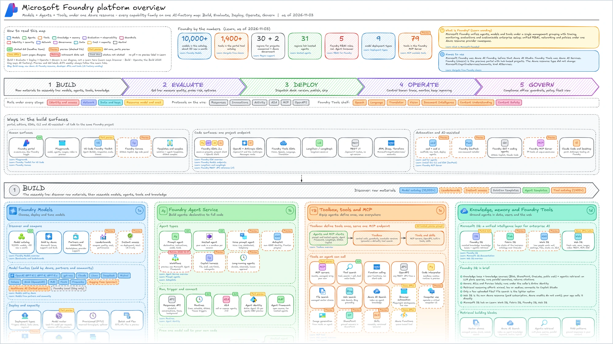

<sub>Excerpt of [`foundry-overview`](diagrams/foundry-overview.excalidraw) (3,620 x 7,318 px, 1,867 elements): The flagship canvas: every Foundry capability family as an icon tile on an AI-factory spine (Build → Evaluate → Deploy → Operate → Govern). Click the image for full resolution.</sub>
<!-- HERO:END -->

A library of dense, hand-drawn **[Excalidraw](https://excalidraw.com)** canvases that explain **Microsoft Foundry** the way a
whiteboard session would: every feature and how the pieces fit together, how to architect, secure, operate and pay for it, and
what happens under the hood. Every canvas cites Microsoft Learn - each card ends in a clickable `Learn:` link and each canvas
closes with a sources panel.

Inspired by Dan Friedman's [Microsoft Fabric explainers](https://difriedman.github.io/explainers/).

> **Unofficial community project** - not affiliated with or endorsed by Microsoft. Foundry changes quickly and many features
> are in preview: every canvas is date-stamped and links to the Learn page behind each claim. Verify before you rely on it.

**Jump to:** [At a glance](#at-a-glance) · [Quick start](#quick-start) · [Screenshots](#a-taste-of-the-canvases) ·
[Library](#the-library) · [Find by topic](#find-by-topic) · [Reading paths](#reading-paths) ·
[How to read a canvas](#how-to-read-a-canvas) ·
[Accuracy](#accuracy-and-freshness) · [Run and publish](#run-and-publish) · [How it is built](#how-it-is-built) ·
[Tooling and QA](#tooling-and-qa) · [Add a canvas](#add-or-update-a-canvas)

## At a glance

<!-- STATS:START -->
| | |
|---|---|
| **Canvases** | **95** in 8 sections; larger topics are split into a main canvas plus `-part-2` |
| **Drawn elements** | **92,898** hand-drawn elements: 51,339 text, 2,935 embedded Azure icons |
| **Citations** | **6,086** clickable Microsoft Learn links (813 unique URLs, verified with `tools/check_links.py`) |
| **Canvas size** | 2,640 - 6,538 px wide, 2,628 - 11,179 px tall; 61 MB of compact JSON in total |
| **Content date** | Facts are current as of **2026-11-03** (stamped on each canvas); preview features are marked |

| # | Section | Canvases | Scope |
|---|---|---|---|
| 1 | **Foundry overview** | 9 | The platform at a glance: every capability, the resource model, how Foundry evolved and where to start. |
| 2 | **Feature deep dives** | 42 | Agent Service, models, Toolbox and MCP, observability, tracing, guardrails, control plane and cost - in detail. |
| 3 | **Reference architectures** | 11 | Common scenarios and the Azure landing zone, drawn end to end. |
| 4 | **BCDR and resiliency** | 5 | High availability, regional failover, Agent Service disaster recovery and runbooks. |
| 5 | **Authentication and authorization** | 7 | Identity types, RBAC roles, agent identity, delegation, network and data protection. |
| 6 | **AI Ops** | 5 | AgentOps: lifecycle, CI/CD, monitoring, FinOps and capacity operations. |
| 7 | **Surrounding services** | 4 | AI Search, Cosmos DB, the IQ layer and the Azure services Foundry plugs into. |
| 8 | **Under the hood** | 12 | How Agent Service, hosted agents, model serving, retrieval and safety work internally. |
<!-- STATS:END -->

## Quick start

```powershell
npm install
npm run dev        # gallery + viewer on http://localhost:5391
```

To open a canvas without the viewer, drag its `.excalidraw` file into [excalidraw.com](https://excalidraw.com) or open it with
the VS Code Excalidraw extension. GitHub displays `.excalidraw` files as raw JSON, so browse with the viewer (or the hosted
site once Pages is enabled - see [Run and publish](#run-and-publish)).

## A taste of the canvases

One excerpt per area. Each image is a crop of the real canvas, rendered by the same Excalidraw exporter that produced the
files (`node tools/render.mjs --shots`); click an image for full resolution. The captions summarise what is drawn - they are
technical notes, not marketing.

<!-- GALLERY:START -->
### Pick your agent kind

**Feature deep dive · Agent Service** · excerpt of [`agent-service-overview`](diagrams/agent-service-overview.excalidraw) (3,000 x 7,306 px, 962 elements, 48 Learn links)

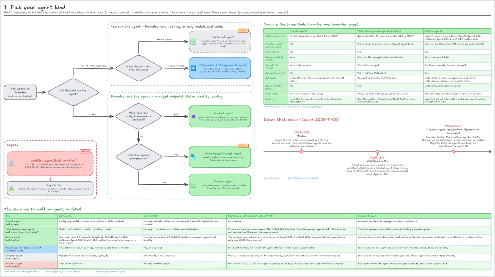

`AgentVersion.definition` is a union of five kinds (`hosted`, `prompt`, `workflow`, `external`, `voice`). The canvas draws it as a decision flow and compares the kinds Foundry runs for you.

- **Decision flow:** who runs the agent? → do you need your own code, framework or protocol? → is it a real-time spoken conversation? Legacy workflow agents are drawn as retiring (2026-12-01) with their migration path.
- **Comparison matrix** (prompt vs voice-based prompt vs hosted): authoring surface, runtime code you maintain, compute, managed endpoint, autoscale, agent identity, cost model.
- **'The six ways to build an agent'** table (defined by / who runs it / status / choose it when) and the dates that matter.

<sub>**Same topic:** [Agent Service: setup, limits, regions and Azure Government](diagrams/agent-service-overview-part-2.excalidraw) · [Prompt agents in depth](diagrams/prompt-agents.excalidraw) · [Hosted agents: your code on Foundry's runtime](diagrams/hosted-agents.excalidraw) · [Workflows, routines, A2A and multi-agent orchestration](diagrams/workflows-multi-agent.excalidraw) · [Foundry Memory (Preview): long-term memory for agents](diagrams/memory.excalidraw) · [Voice agents (Preview): architecture, definition and telephony](diagrams/voice-agents.excalidraw)</sub>

### Deployment types: pick your lane

**Feature deep dive · Models** · excerpt of [`deployment-types`](diagrams/deployment-types.excalidraw) (3,080 x 5,872 px, 701 elements, 52 Learn links)

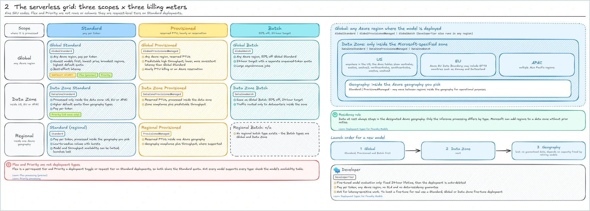

Every way to run a Foundry model as a 3 × 3 grid: processing scope (Global / Data Zone / Regional) × billing meter (Standard / Provisioned / Batch), with the SKU code for each cell.

- **Per cell:** where inference is processed, how it bills and what is guaranteed (`GlobalStandard`, `DataZoneProvisionedManaged`, `GlobalBatch` ...; there is no Regional Batch).
- **Residency rule:** data at rest stays in the designated Azure geography; only inference processing differs. New-model launch order: Global → Data Zone → Geography. Plus the Developer tier.
- **Callout:** Flex and Priority are request-level tiers on Standard deployments, not deployment types.
- The canvas continues with managed compute, instant access, partner serverless, model router and a 'which lane?' decision tree (part 2 goes deeper).

<sub>**Same topic:** [Deployment types: the lanes in detail](diagrams/deployment-types-part-2.excalidraw) · [Foundry Models catalog](diagrams/model-catalog.excalidraw) · [PTU and quota](diagrams/ptu-and-quota.excalidraw) · [Model router: one deployment, many models](diagrams/model-router-lifecycle.excalidraw) · [Fine-tuning: from data to a deployed model](diagrams/fine-tuning.excalidraw) · [Model APIs and capabilities: the surface map](diagrams/model-apis-capabilities.excalidraw)</sub>

### Toolbox: one governed MCP endpoint

**Feature deep dive · Tools and MCP** · excerpt of [`toolbox`](diagrams/toolbox.excalidraw) (4,946 x 10,766 px, 1,553 elements, 51 Learn links)

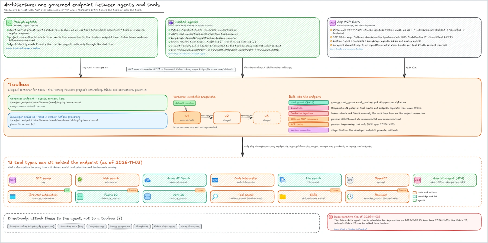

Prompt agents, hosted agents and any MCP client reach tools through a single versioned MCP endpoint hosted in the Foundry project.

- **Two endpoints:** the consumer endpoint always serves `default_version`; the developer endpoint is pinned to a version so you can test before promoting. Versions are immutable snapshots (v1 default → v2 staged → v3 staged).
- **Built into the endpoint:** tool search (BM25), guardrails, credential injection, skills as MCP resources (preview), MCP tasks (preview), version promotion.
- **13 tool types can sit behind it** (MCP server, web search, Azure AI Search, code interpreter, file search, OpenAPI, A2A, browser automation, Fabric IQ, Work IQ, tool search, skills, reminder). **7 are direct-only** and attach to the agent instead (function calling, grounding with Bing, computer use, image generation, SharePoint, Fabric data agent, Azure Functions).

<sub>**Same topic:** [Tool catalog](diagrams/tool-catalog.excalidraw) · [MCP in Foundry: catalogs and servers](diagrams/mcp-catalog-and-servers.excalidraw) · [MCP in Foundry: build, connect and govern](diagrams/mcp-catalog-and-servers-part-2.excalidraw) · [MCP and tool authentication](diagrams/mcp-and-tool-authentication.excalidraw) · [Foundry Tools (formerly Azure AI services)](diagrams/foundry-tools-and-ai-services.excalidraw)</sub>

### Tracing: from agent run to the Traces UI

**Feature deep dive · Observability** · excerpt of [`tracing`](diagrams/tracing.excalidraw) (3,080 x 5,626 px, 590 elements, 41 Learn links)

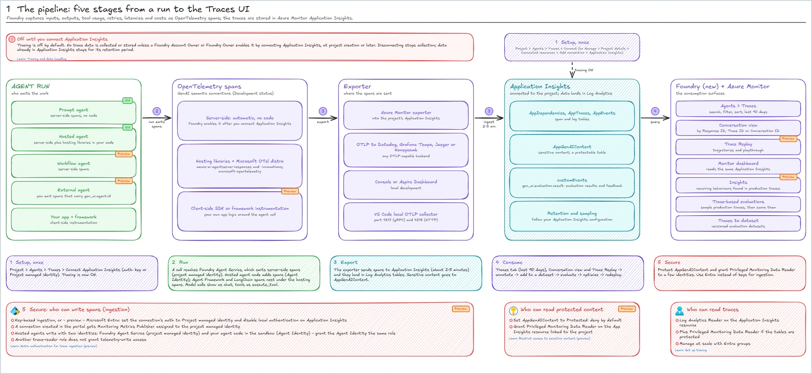

Five stages from an agent run to the Foundry Traces UI, on an OpenTelemetry + Application Insights data spine.

- **Pipeline:** agent run → OpenTelemetry GenAI spans → exporter (Azure Monitor, any OTLP backend, console / Aspire, local collector) → Application Insights tables (`AppDependencies`, `AppTraces`, `AppEvents`, the protectable `AppGenAIContent`) → Foundry Traces, Monitor and Insights.
- **Defaults and timings:** tracing is off until Application Insights is connected; telemetry lands in about 2-5 minutes; the Traces tab keeps 90 days.
- **Security:** Entra authentication for ingestion (preview), who can write spans (project managed identity vs the agent identity of hosted code) and who can read protected content.

<sub>**Same topic:** [Tracing: client-side, replay, datasets and privacy](diagrams/tracing-part-2.excalidraw) · [Foundry Observability: one data model](diagrams/observability-overview.excalidraw) · [Evaluation in depth](diagrams/evaluation.excalidraw) · [AI Red Teaming Agent](diagrams/ai-red-teaming.excalidraw) · [Guardrails and controls](diagrams/guardrails-and-controls.excalidraw)</sub>

### Cost structure: every billing meter

**Feature deep dive · Cost** · excerpt of [`cost-and-billing`](diagrams/cost-and-billing.excalidraw) (3,555 x 3,552 px, 764 elements, 112 Learn links)

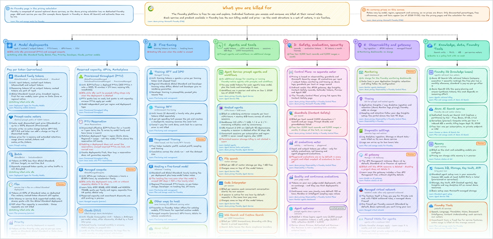

Six billing families, each card giving the unit being metered and whether it bills while idle: model deployments, fine-tuning, agents and tools, safety / evaluation / security, observability and gateway, knowledge / data / Foundry Tools.

- **No invented prices:** the canvas draws meters, units and rules and links out to the Azure pricing pages; rates vary by model, region, agreement and currency.
- **Idle billing is explicit:** provisioned (PTU) and managed compute bill while idle; Standard, Batch, Flex, Priority, Developer, Claude and partner models do not.
- Below the excerpt: billing options, metering, cost scopes and views, and the limits that throttle you.

<sub>**Same topic:** [Cost optimization: levers and decision flow](diagrams/cost-optimization.excalidraw) · [FinOps, capacity and model-lifecycle operations](diagrams/finops-capacity-ops.excalidraw) · [PTU and quota](diagrams/ptu-and-quota.excalidraw) · [AI gateway and token limits](diagrams/ai-gateway-and-token-limits.excalidraw)</sub>

### Foundry in an Azure landing zone

**Reference architecture** · excerpt of [`ra-landing-zone`](diagrams/ra-landing-zone.excalidraw) (3,600 x 8,250 px, 1,366 elements, 62 Learn links)

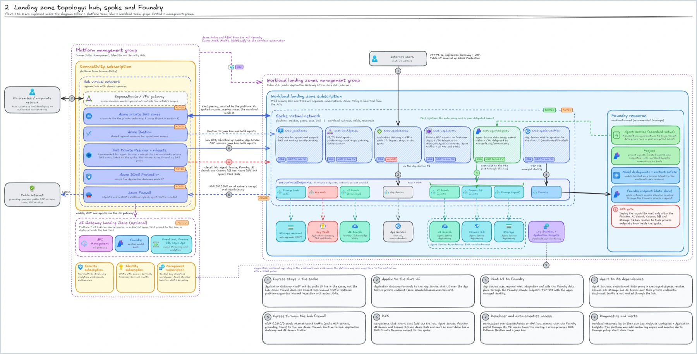

Platform landing zone (connectivity hub) vs workload landing zone (spoke), with the Foundry resource, the standard-setup Agent Service dependencies and eight numbered flows.

- **Platform side:** hub VNet, Azure Firewall, private DNS zones, DNS Private Resolver, Bastion, DDoS Protection and an optional AI gateway landing zone (preview). Azure Policy and RBAC are inherited down the management-group hierarchy.
- **Workload side:** spoke VNet with a delegated agent-egress subnet, private endpoints (Storage, Key Vault, AI Search, Cosmos DB, Foundry), Application Gateway + WAF ingress and your own Agent Service dependencies.
- **Flows 1-8:** ingress stays in the spoke, App Service → Foundry, agent → dependencies (east-west, not via the hub), egress through the hub firewall (UDR), DNS, developer access, diagnostics. A DNS gate callout explains the deployment-order trap.

<sub>**Same topic:** [Foundry in an Azure landing zone, part 2](diagrams/ra-landing-zone-part-2.excalidraw) · [Baseline chat: network-isolated (private endpoints, WAF, standard setup)](diagrams/ra-baseline-network-isolated.excalidraw) · [Basic chat reference architecture (learning / POC)](diagrams/ra-basic-chat.excalidraw) · [Enterprise RAG / knowledge-grounded agent](diagrams/ra-enterprise-rag.excalidraw) · [Reference architecture: multi-agent platform](diagrams/ra-multi-agent-platform.excalidraw) · [Hub AI gateway reference architecture](diagrams/ra-ai-gateway-pattern.excalidraw)</sub>

### Multi-region pattern for Foundry

**BCDR and resiliency** · excerpt of [`bcdr-multi-region-patterns`](diagrams/bcdr-multi-region-patterns.excalidraw) (3,200 x 7,778 px, 996 elements, 60 Learn links)

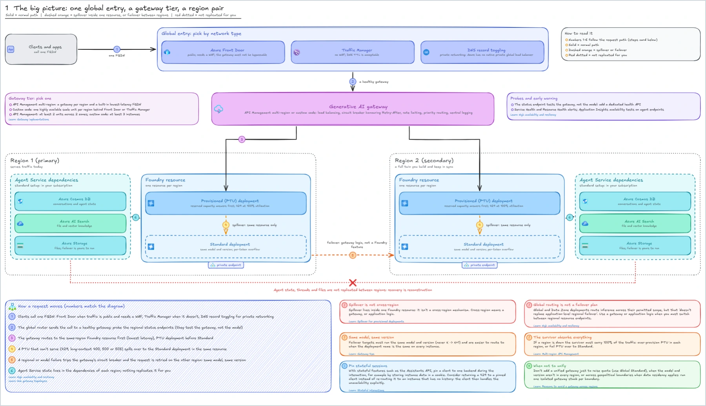

One global entry, a gateway tier and a region pair - drawn with the failure semantics the documentation describes.

- **Global entry by network type:** Azure Front Door (public, needs a WAF), Traffic Manager (no WAF, DNS TTL) or DNS record toggling (private networking). A generative AI gateway (API Management multi-region or custom code) does load balancing, circuit breaking that honours Retry-After, priority routing and central logging.
- **Per region:** a Foundry resource whose PTU deployment spills over to a Standard deployment (same resource only), plus your own Agent Service dependencies (Cosmos DB, AI Search, Storage).
- **Red dotted line:** agent state, threads and files are not replicated between regions - recovery is reconstruction.
- Six numbered request steps and callouts: spillover is not cross-region, global routing is not a failover plan, same model and version everywhere, the survivor absorbs everything, pin stateful sessions.

<sub>**Same topic:** [Foundry high availability and resiliency](diagrams/bcdr-overview.excalidraw) · [Multi-region patterns, part 2](diagrams/bcdr-multi-region-patterns-part-2.excalidraw) · [Agent Service disaster recovery](diagrams/bcdr-agent-service.excalidraw) · [Failure-mode matrix and runbook](diagrams/bcdr-failure-modes-runbook.excalidraw)</sub>

### Who authenticates to what

**Authentication and authorization** · excerpt of [`authn-authz-overview`](diagrams/authn-authz-overview.excalidraw) (3,360 x 7,201 px, 1,124 elements, 63 Learn links)

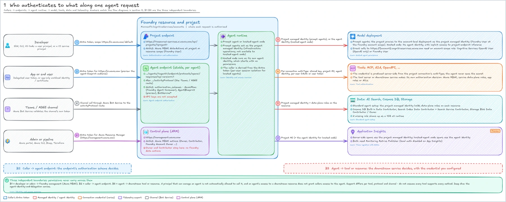

Four caller types, the Foundry boundaries and the downstream resources, with the credential and audience on every arrow.

- **Callers:** developer (Entra token, scope `https://ai.azure.com/.default`), app or end user (agent-blueprint audience, preview), Teams / M365 channel (validated by Azure Bot Service), admin (Azure Resource Manager token).
- **Boundaries:** project endpoint (Azure RBAC data actions, Foundry User), the stable per-agent endpoint (`authorization_schemes`; API keys are not accepted) and the control plane (ARM) where Owner and Contributor stop - they carry no Foundry data actions.
- **Outbound hops:** project managed identity (prompt agents) or agent identity (hosted code) to models; per-connection `authType` to tools; data-plane roles on Cosmos DB, AI Search and Storage; telemetry to Application Insights.
- Three independent boundaries (B1 developer → management, B2 caller → agent endpoint, B3 agent → downstream): permissions never carry across them.

<sub>**Same topic:** [Foundry roles, scopes and least-privilege assignments](diagrams/rbac-roles-and-scopes.excalidraw) · [Agent identity and delegation](diagrams/agent-identity-and-delegation.excalidraw) · [Network isolation](diagrams/network-isolation.excalidraw) · [Data protection and encryption: where your data lives](diagrams/data-protection-encryption.excalidraw) · [MCP and tool authentication](diagrams/mcp-and-tool-authentication.excalidraw)</sub>

### The AgentOps loop

**AI Ops** · excerpt of [`agentops-lifecycle`](diagrams/agentops-lifecycle.excalidraw) (3,000 x 6,960 px, 946 elements, 45 Learn links)

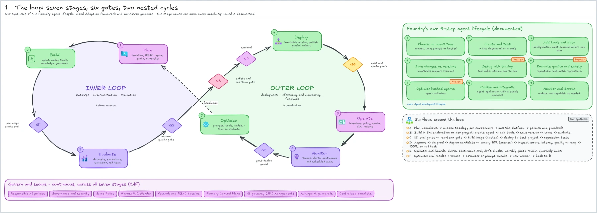

Seven stages, six gates, two nested loops: the inner loop (plan → build → evaluate) before release, the outer loop (deploy → operate → monitor → optimize) in production.

- **Gates:** G1 pre-merge smoke eval · G2 pre-prod quality · G3 safety and red-team · G4 approval · G5 post-deploy guard · G6 cost and quota guard.
- Mapped against Foundry's own documented 9-step agent lifecycle and a CAF 'govern and secure' band (Azure Policy, Defender, Foundry Control Plane, AI gateway, multi-point guardrails).
- Below the excerpt: stage-by-stage capability mapping, environments (exploration / dev-test / production), version ledger, promotion and rollback, change-management triggers and a proposed RACI (labelled as our synthesis, not Microsoft guidance).

<sub>**Same topic:** [CI/CD and infrastructure as code](diagrams/cicd-and-iac.excalidraw) · [Monitoring, alerting and incident response](diagrams/monitoring-alerting-incident.excalidraw) · [FinOps, capacity and model-lifecycle operations](diagrams/finops-capacity-ops.excalidraw) · [AI-assisted operations](diagrams/ai-assisted-ops.excalidraw)</sub>

### Microsoft IQ: the enterprise-context layer

**Surrounding services** · excerpt of [`iq-layer`](diagrams/iq-layer.excalidraw) (3,548 x 7,002 px, 1,065 elements, 53 Learn links)

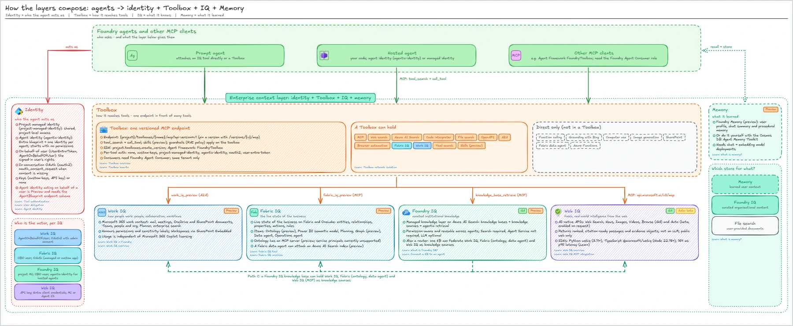

How the context layers compose around an agent: identity + Toolbox + IQ + memory.

- **Four IQ pillars** - Work IQ, Fabric IQ, Foundry IQ and Web IQ - each with the protocol it uses to reach an agent, its preview / GA status and who the actor is (on-behalf-of user, OAuth, project managed identity or agentic identity, API key).
- **Three ways to plug an IQ into an agent:** directly as a tool, through a Toolbox, or as a knowledge-base source - with Foundry Memory drawn beside it ('which store for what?').
- Also on the canvas: connection matrix, auth and onboarding flows, related tools, example scenarios, a timeline and gotchas.

<sub>**Same topic:** [Azure AI Search: the knowledge layer](diagrams/ai-search.excalidraw) · [Azure Cosmos DB in the Foundry ecosystem](diagrams/cosmos-db.excalidraw) · [Azure and Microsoft services around Foundry](diagrams/azure-services-map.excalidraw)</sub>

### One session's Micro VM

**Under the hood** · excerpt of [`hood-hosted-agent-runtime`](diagrams/hood-hosted-agent-runtime.excalidraw) (3,300 x 5,501 px, 710 elements, 67 Learn links)

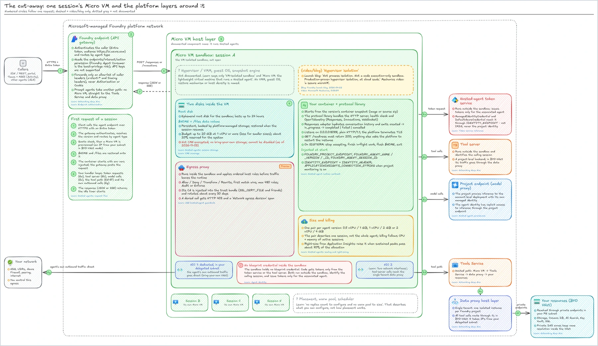

A cut-away of a hosted-agent session: the Micro VM sandbox and the platform layers around it. Solid border = documented in Learn; dashed = video or blog only; dotted grey with '?' = not documented anywhere.

- **Inside the sandbox:** ephemeral root disk (up to 24 hours), a persistent `$HOME` + `/files` volume, your container with the protocol library listening on `:8088`, and an egress proxy with ordered host rules (Allow / Deny / Transform / Rewrite, first match wins, Audit or Enforce) whose CA is injected into the trust bundle. No blueprint credential lives in the sandbox.
- **Outside it:** the hosted-agent token service (issues tokens for the agent identity, never the project identity), the tool server, the project endpoint (model proxy) and the Tools service → data proxy → your BYO-VNet resources. Numbered circles follow one request.
- **Drawn as '?':** the hypervisor / VMM, guest OS, snapshot engine, placement and warm-pool scheduler.

<sub>**Same topic:** [Agent Service architecture (the blueprint)](diagrams/hood-agent-service-architecture.excalidraw) · [One Responses call, end to end](diagrams/hood-request-lifecycle.excalidraw) · [Model serving internals](diagrams/hood-model-serving.excalidraw) · [Agentic retrieval and Foundry IQ: the pipeline under the hood](diagrams/hood-agentic-retrieval.excalidraw) · [Networking internals: container injection and private paths](diagrams/hood-networking-injection.excalidraw) · [Safety pipeline: inline guardrails under the hood](diagrams/hood-safety-pipeline.excalidraw)</sub>
<!-- GALLERY:END -->

## The library

Expand a section to see its canvases. Large topics are split into a main canvas plus a `-part-2`.

<!-- DIAGRAMS:START -->
<details>
<summary><b>1. Foundry overview</b> &nbsp;·&nbsp; 9 canvases &nbsp;·&nbsp; <i>The platform at a glance: every capability, the resource model, how Foundry evolved and where to start.</i></summary>

- The AI-factory map (Build → Evaluate → Deploy → Operate → Govern) with every capability family, status pills and the deprecation clock.
- An exhaustive two-part capability atlas with about 600 clickable Learn links.
- The resource model (Foundry resource → projects → deployments and connections; control vs data plane), the classic → new evolution and migration playbook, every developer surface and a where-to-start decision tree.

| Preview | Diagram | What it covers |
|---|---|---|
| <a href="diagrams/foundry-overview.excalidraw">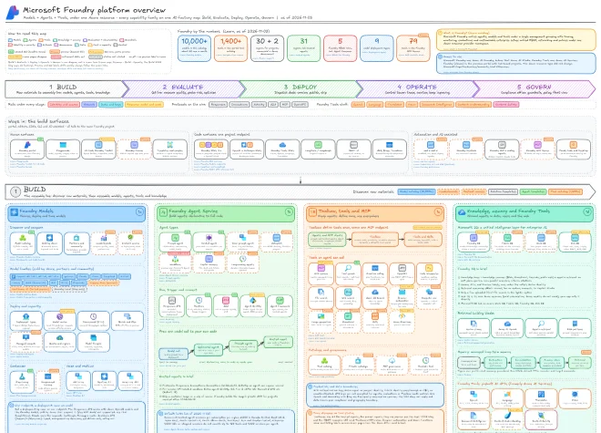</a> | [Microsoft Foundry platform overview <br/><sub>Overview</sub>](diagrams/foundry-overview.excalidraw) | The front-page map of Microsoft Foundry as an AI factory (Build, Evaluate, Deploy, Operate, Govern): every capability family as icon tiles with preview and retirement badges, the platform spine, foundation rails, a runtime request path, the deprecation clock, plus Why Foundry? and How to choose. |
| <a href="diagrams/capability-atlas.excalidraw">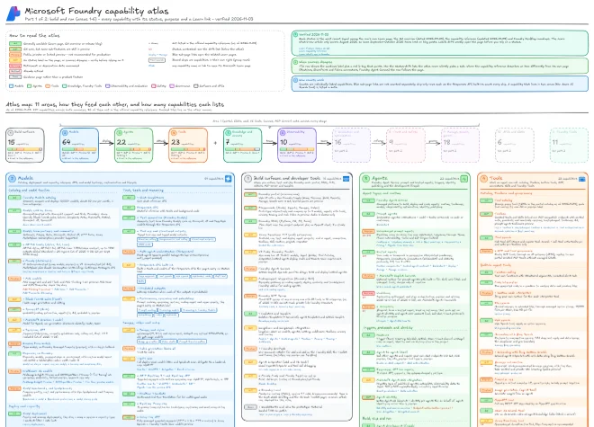</a> | [Foundry capability atlas (part 1) <br/><sub>Overview</sub>](diagrams/capability-atlas.excalidraw) | The exhaustive inventory, part 1 of 2: build surfaces, models, agents, tools, knowledge and observability - every capability with its GA/preview status, one-line purpose and a clickable Learn link. |
| <a href="diagrams/capability-atlas-part-2.excalidraw">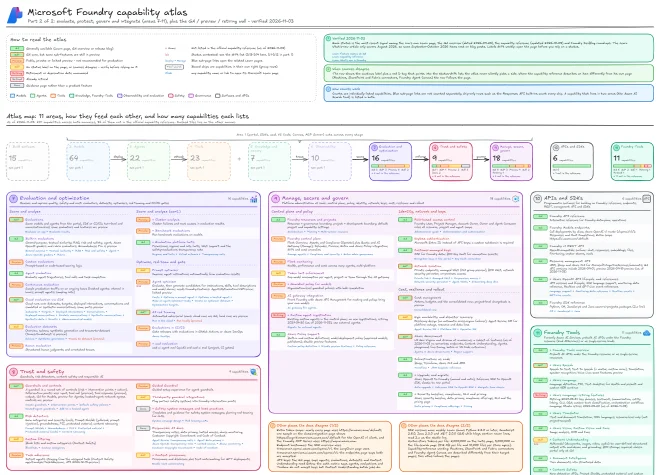</a> | [Foundry capability atlas (part 2) <br/><sub>Overview</sub>](diagrams/capability-atlas-part-2.excalidraw) | The exhaustive inventory, part 2 of 2: evaluation, trust and safety, governance, APIs and SDKs and Foundry Tools - with the GA / preview / retiring status wall and the status-drift notes. |
| <a href="diagrams/where-to-start.excalidraw">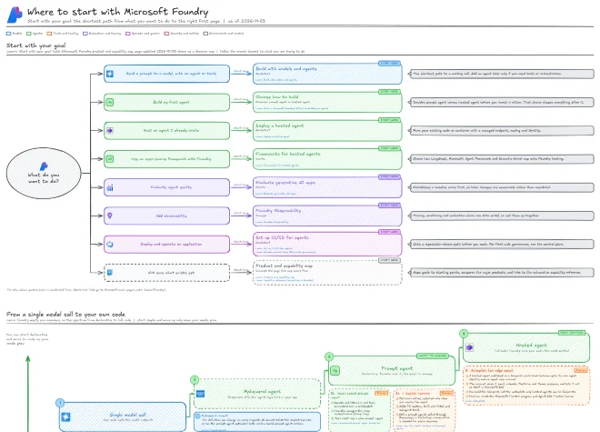</a> | [Where to start with Microsoft Foundry <br/><sub>Overview</sub>](diagrams/where-to-start.excalidraw) | Start with your goal: a decision tree from 'I want to...' to the right first page, the declarative -> full-code spectrum (model call, prompt agent, hosted agent), the five-step path for new developers and a persona -> entry-point map. |
| <a href="diagrams/resource-model.excalidraw">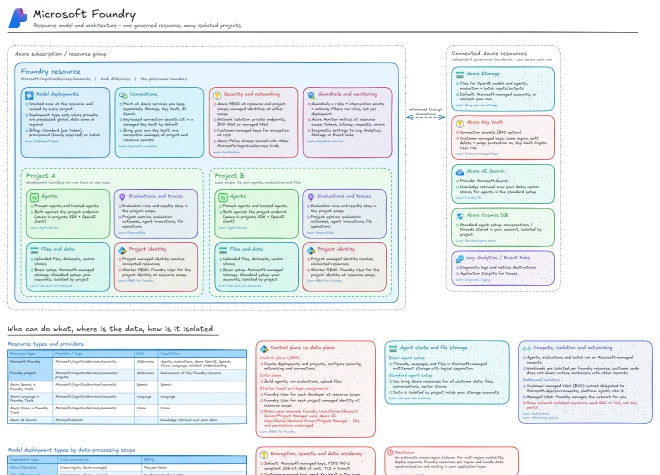</a> | [Foundry resource model <br/><sub>Overview</sub>](diagrams/resource-model.excalidraw) | Foundry resource -> projects -> deployments, connections and connected Azure services; control vs data plane; storage, networking, encryption and data residency. |
| <a href="diagrams/evolution-classic-to-new.excalidraw">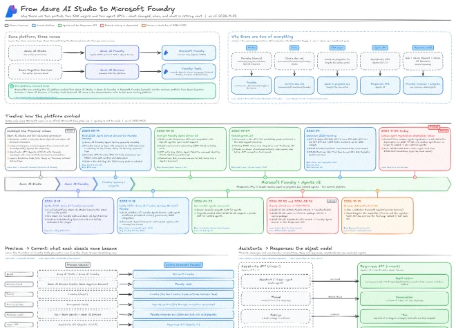</a> | [From Azure AI Studio to Microsoft Foundry <br/><sub>Overview</sub>](diagrams/evolution-classic-to-new.excalidraw) | Why there are two portals, two SDK majors and two agent APIs: the Azure AI Studio -> Azure AI Foundry -> Microsoft Foundry timeline, previous-vs-current mapping, Assistants -> Responses, the deprecation clock and what's new. |
| <a href="diagrams/evolution-classic-to-new-part-2.excalidraw">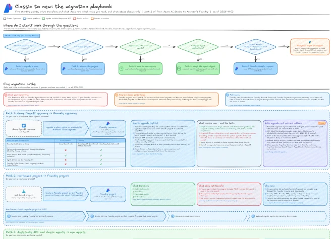</a> | [Classic to new: the migration playbook <br/><sub>Overview</sub>](diagrams/evolution-classic-to-new-part-2.excalidraw) | A decision tree and five swim-arrow migration paths (Azure OpenAI upgrade incl. auto-upgrade, hub to Foundry project, Assistants to agents, Agent Applications, GitHub Models), what stays classic-only, the portal map and agent tool availability. |
| <a href="diagrams/developer-surfaces.excalidraw">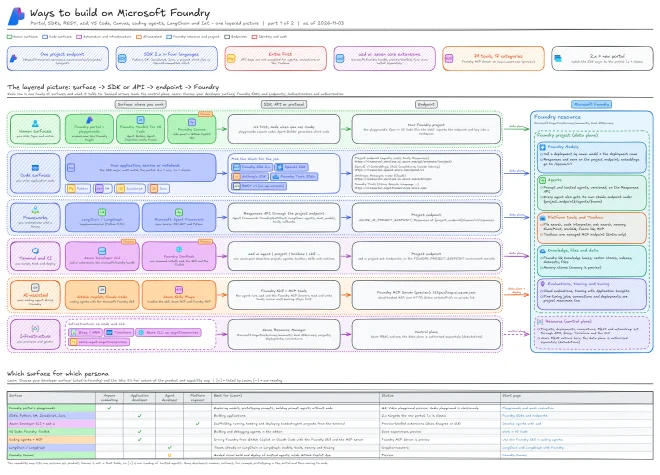</a> | [Ways to build on Microsoft Foundry <br/><sub>Overview</sub>](diagrams/developer-surfaces.excalidraw) | Every way in: portal and playgrounds, SDKs, REST, azd, VS Code, Canvas, coding agents and MCP, LangChain and IaC drawn as one layered picture (surface -> SDK or API -> endpoint -> Foundry), with a surface x persona matrix, endpoints and authentication per surface. |
| <a href="diagrams/developer-surfaces-part-2.excalidraw">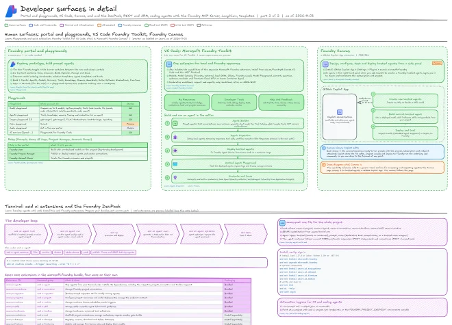</a> | [Developer surfaces in detail <br/><sub>Overview</sub>](diagrams/developer-surfaces-part-2.excalidraw) | Each way in, in detail: portal and playgrounds, VS Code Foundry Toolkit, Canvas, azd ai extensions and the DevPack, REST v1 and ARM, the Foundry Skill and all 79 Foundry MCP Server tools, LangChain, templates and samples. |

</details>

<details>
<summary><b>2. Feature deep dives</b> &nbsp;·&nbsp; 42 canvases &nbsp;·&nbsp; <i>Agent Service, models, Toolbox and MCP, observability, tracing, guardrails, control plane and cost - in detail.</i></summary>

- **Agent Service (15 canvases):** the five REST agent kinds, prompt agents (immutable versions, Copilot harness), hosted agents (port-8088 runtime contract, per-session sandbox, isolation keys, token service), workflows (retiring) → Agent Framework patterns, A2A and routines, Foundry Memory, voice agents, publishing to Microsoft 365 / Teams / Agent 365, lifecycle and the agent optimizer.
- **Models (9):** the catalog (sold by Azure vs partners and community), the 3 × 3 deployment grid and request-level tiers, PTU vs quota, model router, version lifecycle and the retirement cliff, fine-tuning, the model API surface map.
- **Tools and MCP (6):** Toolbox, the tool catalog matrix, MCP catalogs and the five kinds of MCP server, every tool authentication mode, Foundry Tools.
- **Observability and safety (6):** one OpenTelemetry + Application Insights data model, tracing, evaluators by family, the AI Red Teaming Agent, guardrails at four intervention points.
- **Control plane and cost (6):** the Foundry Control Plane, the AI gateway and token limits, governance and policy, every billing meter, cost-optimization levers.

| Preview | Diagram | What it covers |
|---|---|---|
| <a href="diagrams/agent-service-overview.excalidraw">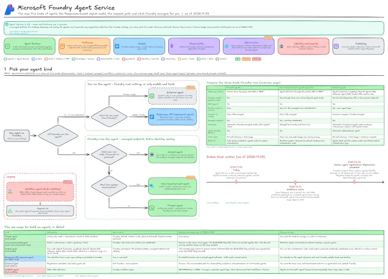</a> | [Foundry Agent Service: the map <br/><sub>Agent Service</sub>](diagrams/agent-service-overview.excalidraw) | What Foundry Agent Service is: the five REST agent kinds and a decision flow, the request path, the Responses-based object model vs classic Assistants, what the service manages for you, key numbers and the retirement dates. |
| <a href="diagrams/agent-service-overview-part-2.excalidraw">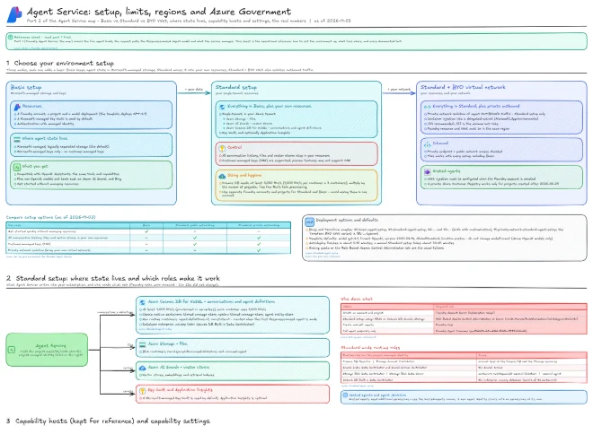</a> | [Agent Service: setup, limits, regions and Azure Government <br/><sub>Agent Service</sub>](diagrams/agent-service-overview-part-2.excalidraw) | Agent Service reference sheet: Basic vs Standard vs Standard + BYO VNet, where state lives, capability hosts and settings, every limit and error code, 30 regions, hosted-session quotas and the Azure Government matrix. |
| <a href="diagrams/prompt-agents.excalidraw">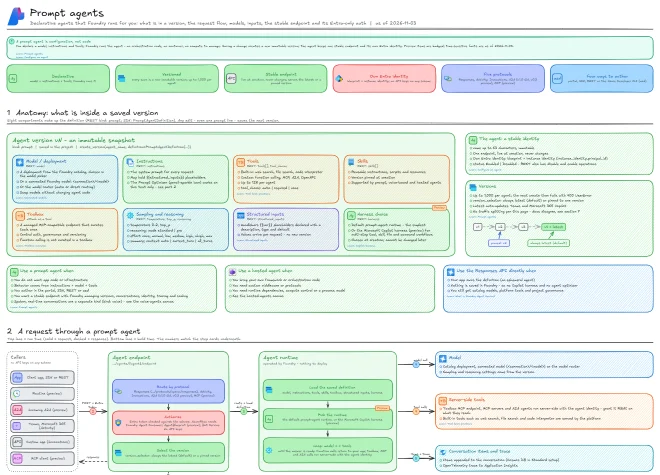</a> | [Prompt agents in depth <br/><sub>Agent Service</sub>](diagrams/prompt-agents.excalidraw) | Prompt agents: what is inside an immutable version, the request flow with numbered steps, connected models and the router, structured inputs, the stable agent endpoint, protocols and Entra-only authorization. |
| <a href="diagrams/prompt-agents-part-2.excalidraw">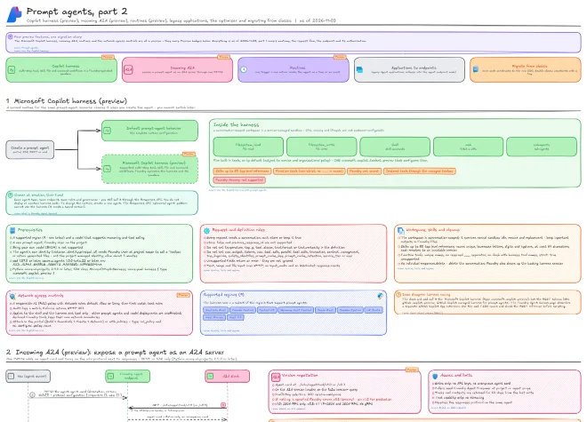</a> | [Prompt agents: harness, A2A, routines and migration <br/><sub>Agent Service</sub>](diagrams/prompt-agents-part-2.excalidraw) | Prompt agents, part 2: the Microsoft Copilot harness (preview) with its tools and rules, incoming A2A (preview), routines (preview), legacy Agent applications, optimizer pointers, and migrating from or disabling classic agents. |
| <a href="diagrams/hosted-agents.excalidraw">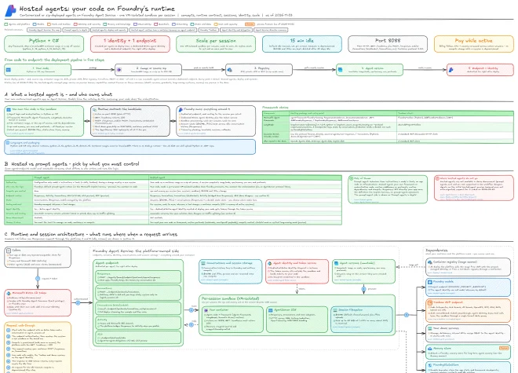</a> | [Hosted agents: your code on Foundry's runtime <br/><sub>Agent Service</sub>](diagrams/hosted-agents.excalidraw) | Hosted agents in depth (concepts): when to pick them over prompt agents, framework choice, the port-8088 runtime contract and protocols, per-session sandboxes, isolation keys, agent identity and the token service, models and Toolbox, scale and regions. |
| <a href="diagrams/hosted-agents-operations.excalidraw">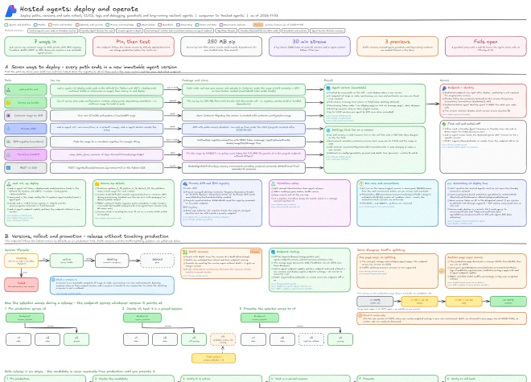</a> | [Hosted agents: deploy and operate <br/><sub>Agent Service</sub>](diagrams/hosted-agents-operations.excalidraw) | Hosted agents in operation: seven deploy paths, versions and safe rollout, CI/CD, logs and debugging, guardrails (preview) and long-running resilient agents (preview) - crash recovery, steering, cancel, human-in-the-loop, stream reconnect and the durable state store. |
| <a href="diagrams/workflows-multi-agent.excalidraw">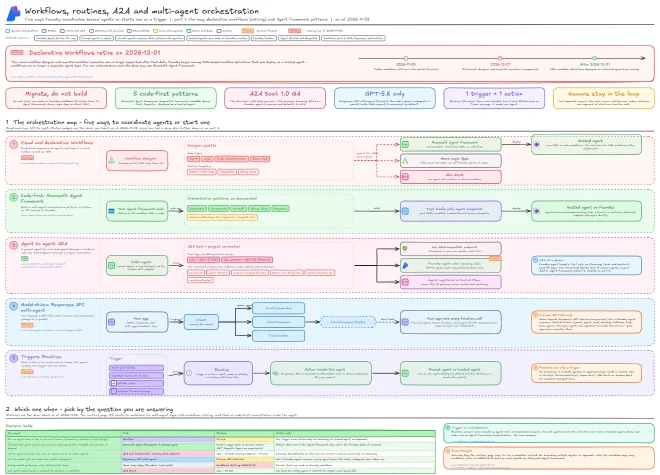</a> | [Workflows, routines, A2A and multi-agent orchestration <br/><sub>Agent Service</sub>](diagrams/workflows-multi-agent.excalidraw) | The orchestration map: declarative workflows (retiring 2026-12-01) and where they go, the five Microsoft Agent Framework patterns drawn as topologies, A2A, Responses multi-agent and routines side by side, plus human-in-the-loop. |
| <a href="diagrams/workflows-multi-agent-part-2.excalidraw">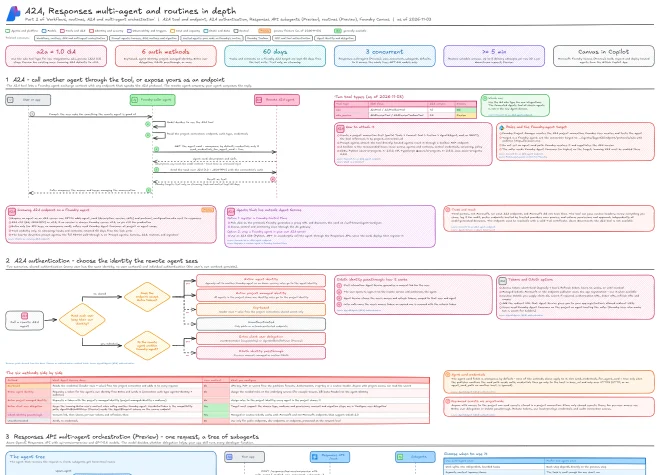</a> | [Multi-agent orchestration in depth: A2A, Responses and routines <br/><sub>Agent Service</sub>](diagrams/workflows-multi-agent-part-2.excalidraw) | A2A in depth (outbound tool call sequence, incoming endpoint, six authentication methods), Responses API multi-agent orchestration (Preview), routines (Preview) and Microsoft Foundry Canvas. |
| <a href="diagrams/memory.excalidraw">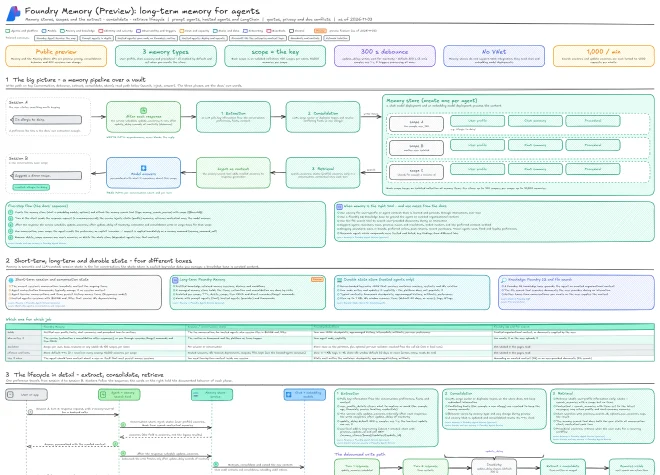</a> | [Foundry Memory (Preview): long-term memory for agents <br/><sub>Agent Service</sub>](diagrams/memory.excalidraw) | Foundry Memory (Preview): memory stores, scopes, the extract-consolidate-retrieve lifecycle, memory types, how prompt, hosted and LangChain agents use it, short-term state vs the durable state store, quotas, privacy and docs conflicts. |
| <a href="diagrams/voice-agents.excalidraw">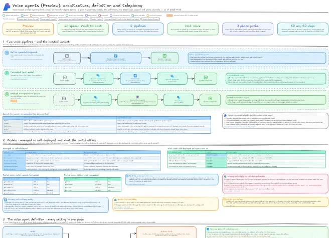</a> | [Voice agents (Preview): architecture, definition and telephony <br/><sub>Agent Service</sub>](diagrams/voice-agents.excalidraw) | Voice-based prompt agents (Preview): native speech-to-speech vs cascaded pipelines, managed vs self-deployed models, every setting of the voice agent definition, the WebSocket session and the telephony path (Teams Phone, Twilio, Direct SIP). |
| <a href="diagrams/voice-agents-part-2.excalidraw">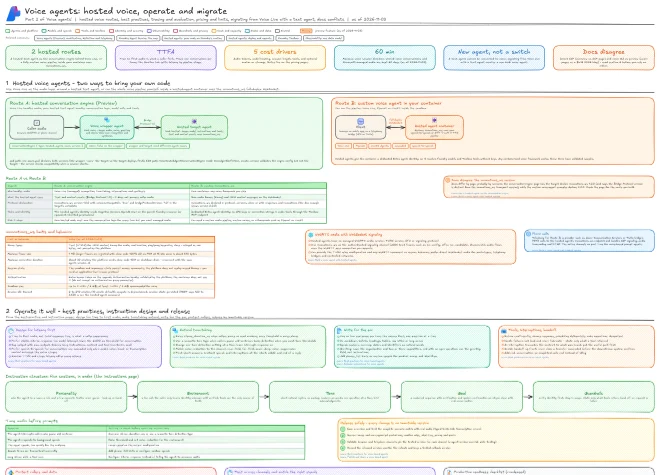</a> | [Voice agents: hosted voice, operate and migrate <br/><sub>Agent Service</sub>](diagrams/voice-agents-part-2.excalidraw) | Voice agents part 2 (Preview): hosted voice (conversation engine and invocations_ws), best practices, tracing and evaluation, pricing and limits, migrating from Voice Live with a text agent, and the docs conflicts (Direct SIP, GA vs preview). |
| <a href="diagrams/publish-and-channels.excalidraw">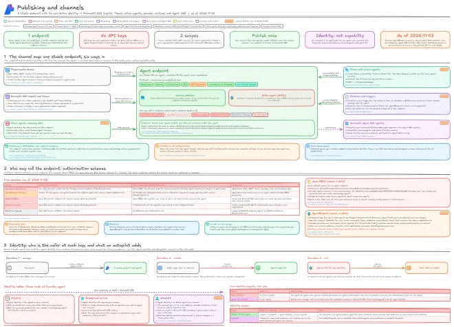</a> | [Publishing and channels: endpoint, Microsoft 365, Teams and identity <br/><sub>Agent Service</sub>](diagrams/publish-and-channels.excalidraw) | How an agent becomes reachable and shareable: the stable endpoint and its authorization schemes, the channel map, Entra agent identity, publishing to Microsoft 365 Copilot and Teams (sequence, scopes, private-network option, authorization fixes), incoming A2A, telephony and the publishing REST operations. |
| <a href="diagrams/publish-and-channels-part-2.excalidraw">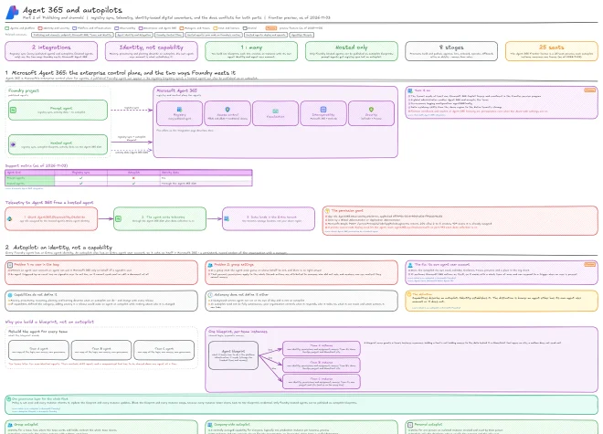</a> | [Agent 365 and autopilots: identity-based digital coworkers <br/><sub>Agent Service</sub>](diagrams/publish-and-channels-part-2.excalidraw) | Microsoft Agent 365 registry sync and telemetry, and autopilots - an identity, not a capability: one blueprint to many hired instances, the eight-stage lifecycle across four roles, onboarding and operating an instance, and the first-autopilot quickstart (25-seat preview). |
| <a href="diagrams/agent-lifecycle-optimizer.excalidraw">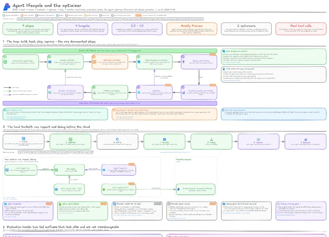</a> | [Agent lifecycle and the optimizer: build, test, ship, improve <br/><sub>Agent Service</sub>](diagrams/agent-lifecycle-optimizer.excalidraw) | The agent development lifecycle as a loop (build, test, trace, evaluate, optimize, publish, monitor), the local toolbelt (azd, Agent Inspector, agent doctor), evaluation hooks, the agent optimizer (Preview) at a glance, release promotion and a what-to-use-when table. |
| <a href="diagrams/agent-lifecycle-optimizer-part-2.excalidraw">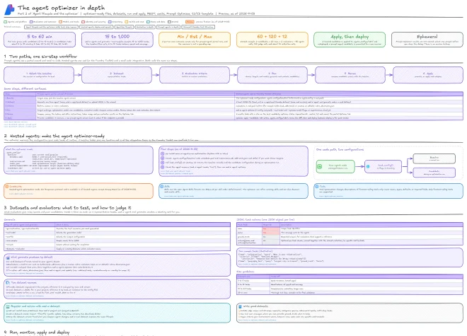</a> | [The agent optimizer in depth: files, datasets, runs, costs and the Prompt Optimizer <br/><sub>Agent Service</sub>](diagrams/agent-lifecycle-optimizer-part-2.excalidraw) | The agent optimizer (Preview) in depth: prompt-agent wizard vs hosted azd path, optimizer-ready files, datasets and evaluators, run, apply and deploy, REST, cost estimates and token usage, the separate Prompt Optimizer and the hosted-agent CI/CD template. |
| <a href="diagrams/model-catalog.excalidraw">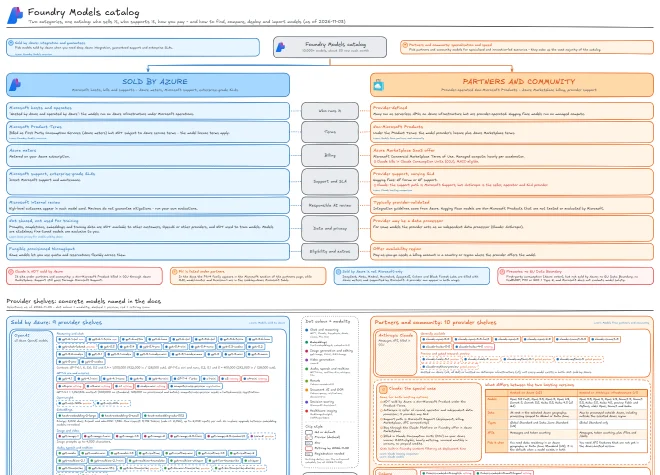</a> | [Foundry Models catalog <br/><sub>Models</sub>](diagrams/model-catalog.excalidraw) | The Foundry Models catalog as a two-wing mall: sold by Azure vs partners and community - who sells, supports and bills (Claude is the special case), provider shelves with real model names, endpoints, discovery and compare tools, Hugging Face and Fireworks routes. |
| <a href="diagrams/deployment-types.excalidraw">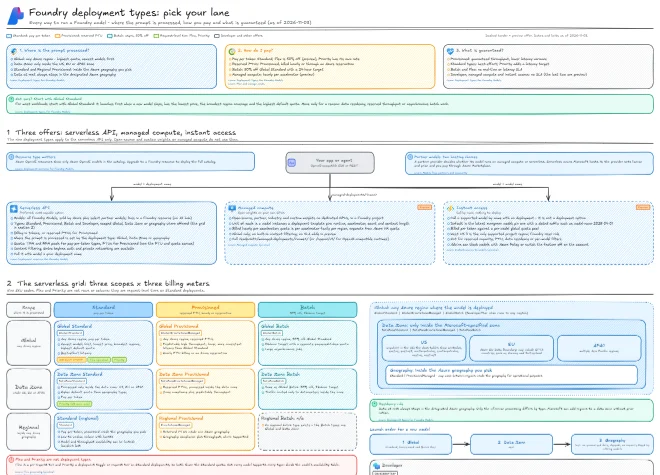</a> | [Deployment types and offers <br/><sub>Models</sub>](diagrams/deployment-types.excalidraw) | Every way to run a Foundry model: the 3x3 serverless grid (Global, Data Zone, geography x Standard, Provisioned, Batch), Developer, Flex and Priority request-level tiers, managed compute, instant access, partner serverless and model router - with data-processing location, billing meter, SLA, limits and a 'which lane?' decision tree. |
| <a href="diagrams/deployment-types-part-2.excalidraw">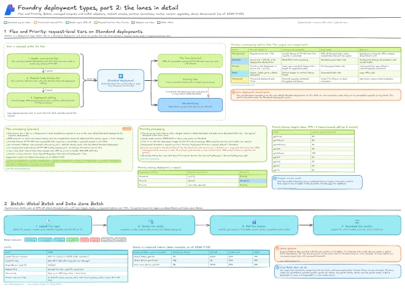</a> | [Deployment types: the lanes in detail <br/><sub>Models</sub>](diagrams/deployment-types-part-2.excalidraw) | Part 2 of the deployment-types map: Flex and Priority request-level tiers, Batch jobs and limits, managed compute and LoRA adapters (preview), instant access (preview), partner serverless, model router, version upgrades per type, Azure Government, Azure Policy and how to create a deployment. |
| <a href="diagrams/ptu-and-quota.excalidraw">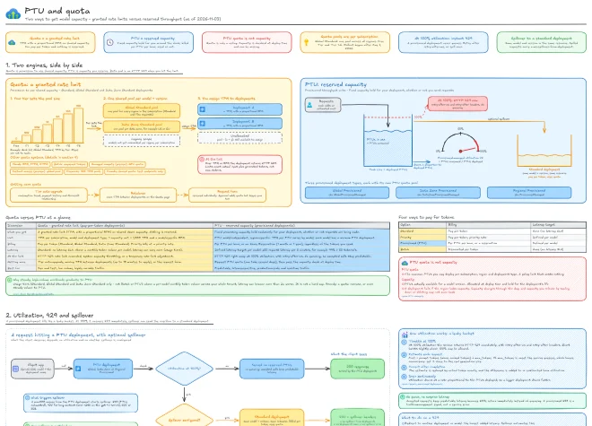</a> | [PTU and quota <br/><sub>Models</sub>](diagrams/ptu-and-quota.excalidraw) | Quota (granted TPM/RPM pools, subscription-level since May 2026, Free and Tier 1-6) versus provisioned throughput (reserved PTUs): sizing, billing and reservations, 429s, spillover, operations and monitoring. |
| <a href="diagrams/model-router-lifecycle.excalidraw">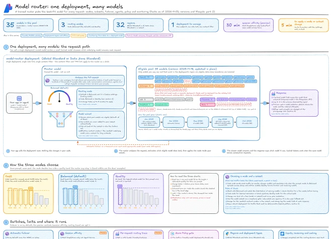</a> | [Model router: one deployment, many models <br/><sub>Models</sub>](diagrams/model-router-lifecycle.excalidraw) | How the model router works - trained router, Cost / Balanced / Quality modes, model subset, failover, session affinity, agents and Responses API, policy governance, monitoring and evaluation (versions and lifecycle continue in part 2). |
| <a href="diagrams/model-router-lifecycle-part-2.excalidraw">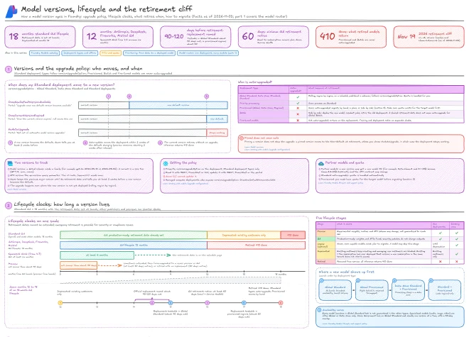</a> | [Model versions, lifecycle and the retirement cliff <br/><sub>Models</sub>](diagrams/model-router-lifecycle-part-2.excalidraw) | How model versions age in Foundry: versionUpgradeOption, who is auto-upgraded, the 18- and 12-month lifecycle clocks, preview rules, the Nov 2026 retirement cliff, migration phases, notifications, the Models API and benchmarks. |
| <a href="diagrams/fine-tuning.excalidraw">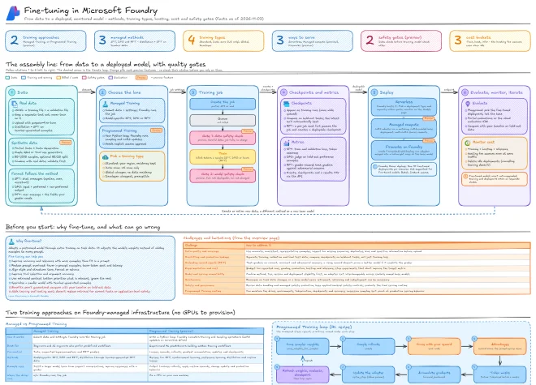</a> | [Fine-tuning: from data to a deployed model <br/><sub>Models</sub>](diagrams/fine-tuning.excalidraw) | End-to-end fine-tuning pipeline with quality gates: Managed vs Programmed Training, SFT/DPO/RFT, training types, supported models, hosting, cost management and safety evaluation. |
| <a href="diagrams/model-apis-capabilities.excalidraw">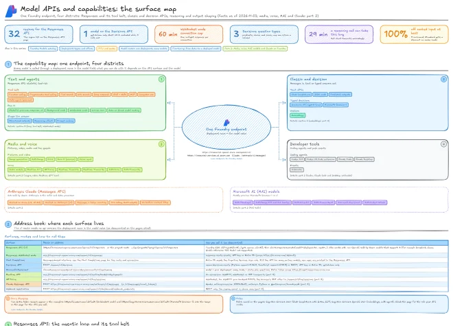</a> | [Model APIs and capabilities: the surface map <br/><sub>Models</sub>](diagrams/model-apis-capabilities.excalidraw) | One Foundry endpoint, four districts: the Responses API and its tool belt, Chat Completions, the Decisions API, reasoning, structured outputs and caching - with an endpoint address book (media, voice, MAI and Claude continue in part 2). |
| <a href="diagrams/model-apis-capabilities-part-2.excalidraw">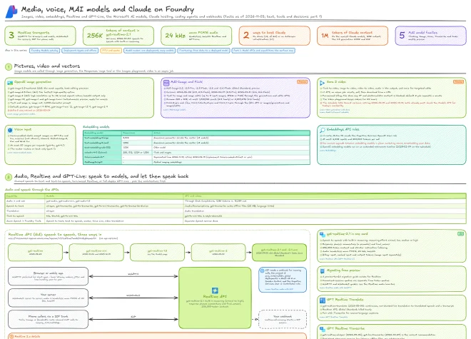</a> | [Media, voice, MAI models and Claude on Foundry <br/><sub>Models</sub>](diagrams/model-apis-capabilities-part-2.excalidraw) | The rest of the capability map: image and video generation, embeddings, audio, Realtime and GPT-Live voice, the Microsoft AI (MAI) models, Claude hosted on Azure or on Anthropic, coding agents and webhooks. |
| <a href="diagrams/toolbox.excalidraw">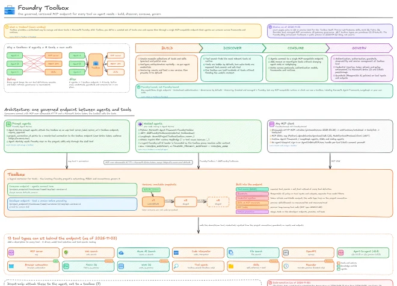</a> | [Foundry Toolbox <br/><sub>Tools and MCP</sub>](diagrams/toolbox.excalidraw) | Toolbox: one versioned, governed MCP endpoint in front of 13 tool types - architecture, versions and promotion, tool search, private catalogs, guardrails, identity, network isolation and the end-to-end flow. |
| <a href="diagrams/tool-catalog.excalidraw">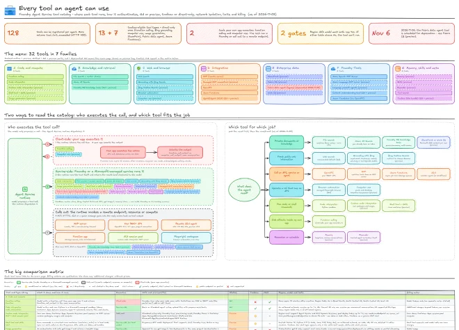</a> | [Tool catalog <br/><sub>Tools and MCP</sub>](diagrams/tool-catalog.excalidraw) | Every tool an agent can use: one comparison matrix of where it runs, auth, GA or preview, toolbox eligibility, network isolation, region/model limits and billing - plus a dispatch diagram and a decision tree. |
| <a href="diagrams/mcp-catalog-and-servers.excalidraw">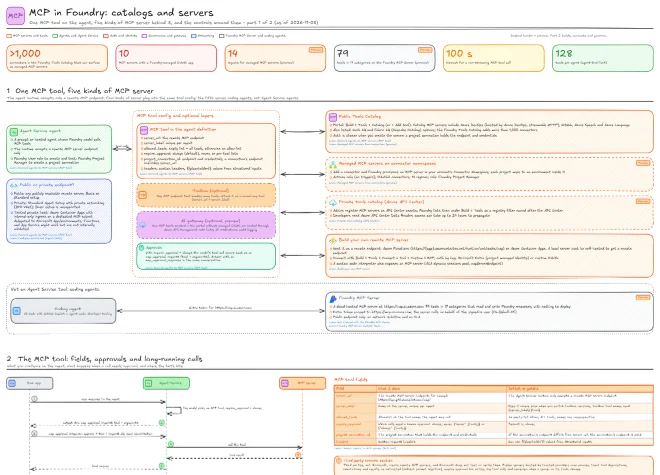</a> | [MCP in Foundry: catalogs and servers <br/><sub>Tools and MCP</sub>](diagrams/mcp-catalog-and-servers.excalidraw) | MCP in Foundry, part 1: one MCP tool and five kinds of MCP server (public Tools Catalog, managed servers on connector namespaces, private API Center catalog, servers you build, the Foundry MCP Server for coding agents), the tool's fields, approval flow and limits, the public catalog and managed MCP servers (preview). |
| <a href="diagrams/mcp-catalog-and-servers-part-2.excalidraw">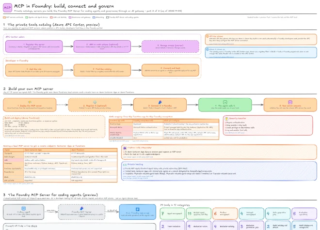</a> | [MCP in Foundry: build, connect and govern <br/><sub>Tools and MCP</sub>](diagrams/mcp-catalog-and-servers-part-2.excalidraw) | MCP in Foundry, part 2: the private API Center catalog (preview), building your own MCP server on Azure Functions or Container Apps, the Foundry MCP Server for coding agents (79 tools in 17 categories, preview), governing MCP with an AI gateway, other levers and transport details. |
| <a href="diagrams/mcp-and-tool-authentication.excalidraw">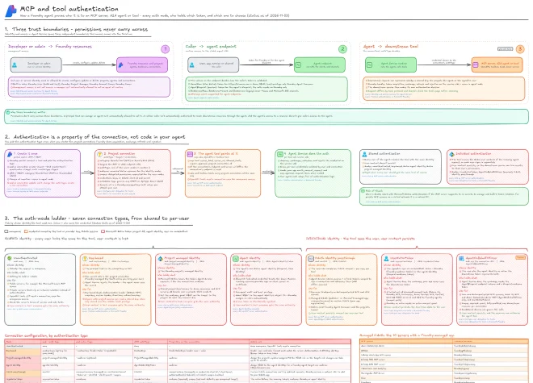</a> | [MCP and tool authentication <br/><sub>Tools and MCP</sub>](diagrams/mcp-and-tool-authentication.excalidraw) | How agents authenticate to MCP servers, A2A agents and tools: every auth mode (none, key, project managed identity, agent identity, OAuth passthrough, UserEntraToken, AgentOnBehalfOfUser), who holds which token, consent, a decision table and gotchas. |
| <a href="diagrams/foundry-tools-and-ai-services.excalidraw"></a> | [Foundry Tools (formerly Azure AI services) <br/><sub>Tools and MCP</sub>](diagrams/foundry-tools-and-ai-services.excalidraw) | What Foundry Tools are, which resource kinds and endpoints back them, and which ones surface as agent tools (Speech and Language MCP, Translator via OpenAPI) versus resource-level or guardrail plumbing only. |
| <a href="diagrams/observability-overview.excalidraw"></a> | [Foundry Observability: one data model <br/><sub>Observability and safety</sub>](diagrams/observability-overview.excalidraw) | Trace, monitor, evaluate and optimize as one closed loop on an OpenTelemetry + Application Insights data spine - control-room surfaces, setup, roles and where every artifact is stored. |
| <a href="diagrams/tracing.excalidraw"></a> | [Tracing: from agent run to the Traces UI <br/><sub>Observability and safety</sub>](diagrams/tracing.excalidraw) | Tracing in Foundry, part 1: the pipeline from an agent run through OpenTelemetry GenAI spans and Application Insights to the Foundry Traces UI, the span hierarchy and attributes, setup per agent kind and framework, and Entra authentication for trace ingestion. |
| <a href="diagrams/tracing-part-2.excalidraw"></a> | [Tracing: client-side, replay, datasets and privacy <br/><sub>Observability and safety</sub>](diagrams/tracing-part-2.excalidraw) | Tracing in Foundry, part 2: client-side tracing (preview), Trace Replay, traces to evaluation datasets, human annotations, restricting sensitive content in AppGenAIContent (the 2026-09-30 cut-over has passed), data handling and retention, and VS Code tracing. |
| <a href="diagrams/evaluation.excalidraw"></a> | [Evaluation in depth <br/><sub>Observability and safety</sub>](diagrams/evaluation.excalidraw) | The Foundry evaluation workbench: every built-in evaluator by family, datasets and simulation, run modes (portal, SDK, azd, CI/CD, continuous), results, limits and regions. |
| <a href="diagrams/ai-red-teaming.excalidraw"></a> | [AI Red Teaming Agent <br/><sub>Observability and safety</sub>](diagrams/ai-red-teaming.excalidraw) | How the AI Red Teaming Agent works: PyRIT attack strategies plus Foundry risk and safety evaluators produce an attack success rate scorecard - risk categories, agentic risks, cloud versus local runs, scheduling and limits. |
| <a href="diagrams/guardrails-and-controls.excalidraw"></a> | [Guardrails and controls <br/><sub>Observability and safety</sub>](diagrams/guardrails-and-controls.excalidraw) | Guardrails end to end: the four intervention points and which risk checks run where, layers that attach a policy, risk catalogue, hosted-agent, toolbox and control-plane guardrails, plus the Responsible AI wrapper. |
| <a href="diagrams/control-plane.excalidraw"></a> | [Foundry Control Plane <br/><sub>Control plane and cost</sub>](diagrams/control-plane.excalidraw) | One role-aware console for the agent fleet: four pillars, Operate and Manage panes, integrations with Defender, Purview, Entra Agent ID and Agent 365, lifecycle controls, token limits, guardrail policies, roles and who sees what. |
| <a href="diagrams/ai-gateway-and-token-limits.excalidraw"></a> | [AI gateway and token limits <br/><sub>Control plane and cost</sub>](diagrams/ai-gateway-and-token-limits.excalidraw) | The Foundry AI gateway (Azure API Management): how it is enabled and billed, the request flow, 429/403 token limits per project and deployment, MCP governance and bring-your-own-model. |
| <a href="diagrams/governance-policy-compliance.excalidraw"></a> | [Governance, policy and compliance <br/><sub>Control plane and cost</sub>](diagrams/governance-policy-compliance.excalidraw) | The governance stack in layers - tenant, management group and subscription, resource group, Foundry resource, project, deployment, agent - with Azure Policy built-ins, the deployment gate, preview suppression and the role that configures each control. |
| <a href="diagrams/governance-policy-compliance-part-2.excalidraw"></a> | [Governance, policy and compliance, part 2 <br/><sub>Control plane and cost</sub>](diagrams/governance-policy-compliance-part-2.excalidraw) | The evidence plane for Foundry governance - diagnostic logging, Defender, Purview, Entra and Agent 365, Service Health and the consolidated view - plus data residency by deployment type, Azure Government availability and co-located versus isolated boundaries. |
| <a href="diagrams/cost-and-billing.excalidraw"></a> | [Microsoft Foundry Cost Structure <br/><sub>Control plane and cost</sub>](diagrams/cost-and-billing.excalidraw) | Every Foundry billing meter by area - models, fine-tuning, agents and tools, safety, observability, data - plus billing options, metering, cost scopes, views and the limits that throttle you. |
| <a href="diagrams/cost-optimization.excalidraw"></a> | [Cost optimization: levers and decision flow <br/><sub>Control plane and cost</sub>](diagrams/cost-optimization.excalidraw) | Pick your lane (router, Batch, Flex, Priority, PTU), set the guardrails, then pull the levers - caching, limits, hosting, evaluation, commitments - with savings, trade-offs and where to set each one. |

</details>

<details>
<summary><b>3. Reference architectures</b> &nbsp;·&nbsp; 11 canvases &nbsp;·&nbsp; <i>Common scenarios and the Azure landing zone, drawn end to end.</i></summary>

- From a learning-grade basic chat to the network-isolated production baseline (Application Gateway + WAF, private endpoints, standard agent setup, agent subnet injection, firewall egress).
- The landing zone in two parts: management groups, hub-spoke topology, who owns what, DNS and egress, ownership models and rollout.
- Enterprise RAG on Foundry IQ, a multi-agent platform, Microsoft 365 / Fabric / event-driven integration (with the identity used on every hop) and the hub AI-gateway pattern on API Management.

| Preview | Diagram | What it covers |
|---|---|---|
| <a href="diagrams/ra-basic-chat.excalidraw"></a> | [Basic chat reference architecture (learning / POC)](diagrams/ra-basic-chat.excalidraw) | The basic Foundry chat architecture redrawn: App Service + Easy Auth, a prompt agent with AI Search and web search grounding, numbered flow, RBAC wiring and what each Well-Architected pillar deliberately leaves out. |
| <a href="diagrams/ra-baseline-network-isolated.excalidraw"></a> | [Baseline chat: network-isolated (private endpoints, WAF, standard setup) <br/><sub>Reference architectures</sub>](diagrams/ra-baseline-network-isolated.excalidraw) | The production baseline for Foundry chat redrawn as a VNet map: Application Gateway + WAF, private endpoints, standard agent setup with your own Cosmos DB, Storage and AI Search, agent subnet injection, Azure Firewall egress, DNS zones, RBAC wiring and trade-offs. |
| <a href="diagrams/ra-baseline-network-isolated-part-2.excalidraw"></a> | [Baseline chat: decisions, operations and gotchas <br/><sub>Reference architectures</sub>](diagrams/ra-baseline-network-isolated-part-2.excalidraw) | Part 2 of the network-isolated baseline: design decisions and trade-offs, which tools work behind the VNet, zone redundancy and disaster recovery, Well-Architected guidance and the production gotchas (WAF tuning, portal access, conversation isolation). |
| <a href="diagrams/ra-landing-zone.excalidraw"></a> | [Foundry in an Azure landing zone](diagrams/ra-landing-zone.excalidraw) | Platform vs workload landing zones for Microsoft Foundry: management groups, the hub-spoke topology with numbered flows, who owns what, private DNS and egress control, and the Agent Service gotchas. |
| <a href="diagrams/ra-landing-zone-part-2.excalidraw"></a> | [Foundry in an Azure landing zone, part 2](diagrams/ra-landing-zone-part-2.excalidraw) | Foundry resource ownership models and the rollout path, Azure Policy guardrails and where they attach, subscription vending and CI/CD, the AI Landing Zones accelerators and Well-Architected notes. |
| <a href="diagrams/ra-enterprise-rag.excalidraw"></a> | [Enterprise RAG / knowledge-grounded agent](diagrams/ra-enterprise-rag.excalidraw) | Foundry IQ knowledge bases on Azure AI Search agentic retrieval: ask, plan, fan out, synthesize; ingestion, per-user security trimming, the private variant, retrieval options and RAG evaluation. |
| <a href="diagrams/ra-multi-agent-platform.excalidraw"></a> | [Reference architecture: multi-agent platform](diagrams/ra-multi-agent-platform.excalidraw) | Orchestrator and specialist agents on Foundry: the five orchestration patterns, A2A, MCP, Toolbox, memory, Entra agent identity, observability and CI/CD - with the Workflows retirement and the gotchas. |
| <a href="diagrams/ra-m365-fabric-integration.excalidraw"></a> | [Microsoft 365, Fabric and event-driven integration <br/><sub>Reference architectures</sub>](diagrams/ra-m365-fabric-integration.excalidraw) | Three islands and a bridge: publish a Foundry agent to Microsoft 365 Copilot and Teams (public, source-IP-filtered route for a private Foundry), Work IQ, SharePoint, Agent 365, Fabric IQ and the Fabric data agent deprecation - with the identity used on every hop and what stays private. |
| <a href="diagrams/ra-m365-fabric-integration-part-2.excalidraw"></a> | [Microsoft 365, Fabric and event-driven integration: autopilots, routines and operations <br/><sub>Reference architectures</sub>](diagrams/ra-m365-fabric-integration-part-2.excalidraw) | Part 2: the autopilot lifecycle as a four-lane swimlane, routines, the Azure Functions queue pattern, Logic Apps, which integrations survive network isolation, design decisions, gotchas and the documented Well-Architected guidance. |
| <a href="diagrams/ra-ai-gateway-pattern.excalidraw"></a> | [Hub AI gateway reference architecture <br/><sub>Reference architectures</sub>](diagrams/ra-ai-gateway-pattern.excalidraw) | Azure API Management as the hub AI gateway in front of Foundry models, MCP tools and agents: the eight-step policy pipeline with a numbered request flow, the four Architecture Center topologies, multi-region and per-boundary variants. |
| <a href="diagrams/ra-ai-gateway-pattern-part-2.excalidraw"></a> | [Hub AI gateway reference architecture, part 2 <br/><sub>Reference architectures</sub>](diagrams/ra-ai-gateway-pattern-part-2.excalidraw) | How Foundry plugs into the gateway (per-project token limits, MCP governance, bring your own model), MCP servers behind API Management, the Citadel Governance Hub with its contracts and network options, and the design decisions. |

</details>

<details>
<summary><b>4. BCDR and resiliency</b> &nbsp;·&nbsp; 5 canvases &nbsp;·&nbsp; <i>High availability, regional failover, Agent Service disaster recovery and runbooks.</i></summary>

- The layered resilience stack: what Microsoft builds in, what you own, zones, regional failure, deployment-type resiliency and SLAs.
- Multi-region patterns (active/active, active/passive), PTU → Standard spillover, quota across regions, retry / backoff / circuit breaking and three failure walk-throughs.
- Agent Service DR playbooks (platform or regional outage; resource and data loss) and a matrix of 32 failure modes with a 15-minute triage flow, alert pack and drill plan.

| Preview | Diagram | What it covers |
|---|---|---|
| <a href="diagrams/bcdr-overview.excalidraw"></a> | [Foundry high availability and resiliency](diagrams/bcdr-overview.excalidraw) | The layered resilience stack: what Microsoft builds in, what you own, availability zones, regional failure, deployment-type resiliency, SLAs and what you must replicate yourself. |
| <a href="diagrams/bcdr-multi-region-patterns.excalidraw"></a> | [Multi-region patterns](diagrams/bcdr-multi-region-patterns.excalidraw) | Region-pair topologies behind Front Door, Traffic Manager or API Management (active/active and active/passive), PTU-to-Standard spillover mechanics and quota planning across regions, drawn from the documented patterns. |
| <a href="diagrams/bcdr-multi-region-patterns-part-2.excalidraw"></a> | [Multi-region patterns, part 2](diagrams/bcdr-multi-region-patterns-part-2.excalidraw) | Retry, backoff and circuit-breaker mechanics, health probes, three failure walk-throughs drawn as before/after topologies (regional model outage, PTU exhausted, dependency outage), agent-state consistency and rebuild with IaC. |
| <a href="diagrams/bcdr-agent-service.excalidraw"></a> | [Agent Service disaster recovery](diagrams/bcdr-agent-service.excalidraw) | Standard-setup Agent Service DR from all three DR pages: where state lives, what Microsoft recovers vs what you rebuild, the platform-outage and resource/data-loss playbooks with documented RTO and recovery points. |
| <a href="diagrams/bcdr-failure-modes-runbook.excalidraw"></a> | [Failure-mode matrix and runbook](diagrams/bcdr-failure-modes-runbook.excalidraw) | What breaks, how you see it, what you do and whose job recovery is: 32 failure modes across models, agents, state, edge, identity and tools, plus a 15-minute triage flow, the alert pack and a drill plan. |

</details>

<details>
<summary><b>5. Authentication and authorization</b> &nbsp;·&nbsp; 7 canvases &nbsp;·&nbsp; <i>Identity types, RBAC roles, agent identity, delegation, network and data protection.</i></summary>

- Identity types, Entra ID vs keys, token audiences, control vs data plane and five numbered request-flow sequences.
- Every built-in role and the scope ladder down to a single agent, least-privilege starters, elevated tasks and a permission-error cheat sheet.
- Entra Agent ID (blueprint + per-agent identity), user delegation and consent, network isolation (inbound private endpoints, outbound BYO-VNet injection vs managed VNet) and data protection (trust-boundary map, customer-managed keys end to end).

| Preview | Diagram | What it covers |
|---|---|---|
| <a href="diagrams/authn-authz-overview.excalidraw"></a> | [Authentication and authorization map](diagrams/authn-authz-overview.excalidraw) | Who proves what to whom: identity types, Entra ID vs API keys, token audiences, control vs data plane, connections and secrets, plus five numbered request-flow sequences. |
| <a href="diagrams/rbac-roles-and-scopes.excalidraw"></a> | [Foundry roles, scopes and least-privilege assignments](diagrams/rbac-roles-and-scopes.excalidraw) | Every built-in Foundry role and related role (control plane vs data plane), the scope ladder down to one agent, role-by-capability matrices, starter least-privilege assignments and the places where Learn pages disagree. |
| <a href="diagrams/rbac-roles-and-scopes-part-2.excalidraw"></a> | [Foundry roles, part 2: elevated tasks, feature roles and Azure Policy](diagrams/rbac-roles-and-scopes-part-2.excalidraw) | Which tasks force Owner or User Access Administrator, the roles the project managed identity holds on backing resources, extra roles per feature (evaluations, tracing, Agent 365, hosted agents, publishing), Azure Policy beside RBAC and a permission-error cheat sheet. |
| <a href="diagrams/agent-identity-and-delegation.excalidraw"></a> | [Agent identity and delegation](diagrams/agent-identity-and-delegation.excalidraw) | Entra Agent ID (blueprint + per-agent identity), endpoint authorization schemes, user delegation and consent, the hosted-agent token service and per-user session isolation - who is the caller at each hop. |
| <a href="diagrams/network-isolation.excalidraw"></a> | [Network isolation](diagrams/network-isolation.excalidraw) | Inbound (public network access, private endpoints, private DNS), outbound (BYO VNet container injection vs managed VNet), Network Security Perimeter, on-premises access, tool support, subnet sizing and build order. |
| <a href="diagrams/data-protection-encryption.excalidraw"></a> | [Data protection and encryption: where your data lives](diagrams/data-protection-encryption.excalidraw) | A trust-boundary map of where prompts, agent state, traces and secrets live and who can see them, plus the data commitments, residency by deployment type, abuse monitoring, protected trace content and the Customer Copyright Commitment. |
| <a href="diagrams/data-protection-encryption-part-2.excalidraw"></a> | [Data protection, part 2: keys, secrets, storage and compliance](diagrams/data-protection-encryption-part-2.excalidraw) | Customer-managed keys end to end (prerequisites, enablement, rotation, revocation), Key Vault for connection secrets, managed vs your own storage, the security-baseline control families, Defender, Purview and Azure Government. |

</details>

<details>
<summary><b>6. AI Ops</b> &nbsp;·&nbsp; 5 canvases &nbsp;·&nbsp; <i>AgentOps: lifecycle, CI/CD, monitoring, FinOps and capacity operations.</i></summary>

- The AgentOps loop, a ten-station CI/CD pipeline (Bicep, Terraform, azd, evaluation gates, quota-aware deployment) and a five-ring monitoring signal map with an alert catalogue.
- FinOps cadence (quota, PTU, reservations, token budgets, chargeback) and model-retirement operations.
- AI-assisted operations: Foundry MCP Server (preview), Foundry Skill, `azd ai agent doctor`, Insights, Azure SRE Agent and Azure Copilot agents - with what each can and cannot do.

| Preview | Diagram | What it covers |
|---|---|---|
| <a href="diagrams/agentops-lifecycle.excalidraw"></a> | [AgentOps lifecycle](diagrams/agentops-lifecycle.excalidraw) | The end-to-end AgentOps loop on Foundry: plan, build, evaluate, deploy, operate, monitor, optimize - environments, versioning, gates, promotion and rollback, and who owns what. |
| <a href="diagrams/cicd-and-iac.excalidraw"></a> | [CI/CD and infrastructure as code](diagrams/cicd-and-iac.excalidraw) | A ten-station pipeline with platform, app and gate lanes; which API surface each artefact lives on; Bicep, Terraform and azd; evaluation gates, quota-aware deployment, ACR options and rollout. |
| <a href="diagrams/monitoring-alerting-incident.excalidraw"></a> | [Monitoring, alerting and incident response](diagrams/monitoring-alerting-incident.excalidraw) | The five-ring signal map (resource vs project scope), model and agent metrics, alert catalogue, on-call flow and the trace-to-dataset feedback loop for operating Foundry workloads. |
| <a href="diagrams/finops-capacity-ops.excalidraw"></a> | [FinOps, capacity and model-lifecycle operations](diagrams/finops-capacity-ops.excalidraw) | The operating cadence for quota, PTU and reservations, token budgets, chargeback and cleanup - plus model retirement ops: the schedule watch, NoAutoUpgrade pitfalls and regression testing on upgrade. |
| <a href="diagrams/ai-assisted-ops.excalidraw"></a> | [AI-assisted operations](diagrams/ai-assisted-ops.excalidraw) | Using AI to operate Foundry: the Foundry MCP Server (preview), Foundry Skill, azd ai agent doctor (not AI), Insights, Azure SRE Agent and Azure Copilot agents - what each can and cannot do, and what the docs do not say. |

</details>

<details>
<summary><b>7. Surrounding services</b> &nbsp;·&nbsp; 4 canvases &nbsp;·&nbsp; <i>AI Search, Cosmos DB, the IQ layer and the Azure services Foundry plugs into.</i></summary>

- Azure AI Search as the Foundry IQ knowledge layer: knowledge bases and sources, agentic retrieval, identity and per-user trimming, networking, tiers and billing.
- Cosmos DB in the standard agent setup (the `enterprise_memory` database and containers, RBAC, what Foundry does not back up) and as agent memory, vector store, semantic cache and MCP tool.
- Work IQ, Fabric IQ, Foundry IQ and Web IQ, and a hub-and-spoke map of every Azure and Microsoft service that plugs into Foundry.

| Preview | Diagram | What it covers |
|---|---|---|
| <a href="diagrams/ai-search.excalidraw"></a> | [Azure AI Search: the knowledge layer](diagrams/ai-search.excalidraw) | Foundry IQ knowledge bases on Azure AI Search: knowledge sources, agentic retrieval, classic indexes, the three ways agents use search content, identity, networking, trimming, tiers and billing. |
| <a href="diagrams/cosmos-db.excalidraw"></a> | [Azure Cosmos DB in the Foundry ecosystem](diagrams/cosmos-db.excalidraw) | The standard agent setup's enterprise_memory database and containers, RBAC, private networking, what Foundry does not back up, plus Cosmos DB as agent memory, vector store, semantic cache, MCP tool and Fabric mirror source. |
| <a href="diagrams/iq-layer.excalidraw"></a> | [Microsoft IQ: the enterprise-context layer](diagrams/iq-layer.excalidraw) | Work IQ, Fabric IQ, Foundry IQ and Web IQ: what each provides, how it reaches a Foundry agent (tool, Toolbox or knowledge-base source), auth and trimming, prerequisites, network support and status. |
| <a href="diagrams/azure-services-map.excalidraw"></a> | [Azure and Microsoft services around Foundry](diagrams/azure-services-map.excalidraw) | Hub-and-spoke map of every Azure and Microsoft service that plugs into Foundry: the role it plays, which feature needs it, mandatory vs bring-your-own, and the connection, auth and network pattern. |

</details>

<details>
<summary><b>8. Under the hood</b> &nbsp;·&nbsp; 12 canvases &nbsp;·&nbsp; <i>How Agent Service, hosted agents, model serving, retrieval and safety work internally.</i></summary>

- Cut-aways of the Agent Service blueprint (control vs data plane, registry, runtime, state, model gateway) and of the per-session Micro VM sandbox.
- One Responses call hop by hop (prompt vs hosted agent, four guardrail gates), model-serving internals (routing, TPM/RPM gate vs PTU leaky bucket, spillover), the agentic-retrieval pipeline, networking injection, the safety and observability pipelines and Foundry Memory.
- Every fact is tagged **documented**, **video or blog only**, or **not documented**; a curated shelf of 29 sources (19 videos and sessions) records how far to trust each.

| Preview | Diagram | What it covers |
|---|---|---|
| <a href="diagrams/hood-agent-service-architecture.excalidraw"></a> | [Agent Service architecture (the blueprint)](diagrams/hood-agent-service-architecture.excalidraw) | Cut-away map of Foundry Agent Service: front door, control vs data plane, registry and versions, the runtime (prompt vs hosted path), state stores, tools, model gateway and the identity, guardrail and tracing hooks - with what the docs do not say drawn as grey question marks. |
| <a href="diagrams/hood-hosted-agent-runtime.excalidraw"></a> | [Hosted agent runtime: how a container becomes an agent endpoint](diagrams/hood-hosted-agent-runtime.excalidraw) | Cut-away of the per-session Micro VM sandbox and the platform layers around it - build and provision, runtime contract, session lifecycle, identity, egress proxy, networking and crash recovery - with documented, video/blog-only and not-documented facts drawn differently. |
| <a href="diagrams/hood-request-lifecycle.excalidraw"></a> | [One Responses call, end to end](diagrams/hood-request-lifecycle.excalidraw) | A single Responses call followed hop by hop for a prompt agent and for a hosted agent: which component handles each step, which identity is on the wire, where the four guardrail gates sit, and what is persisted, streamed and traced. |
| <a href="diagrams/hood-request-lifecycle-part-2.excalidraw"></a> | [One Responses call, part 2: variants, limits and what nobody documents](diagrams/hood-request-lifecycle-part-2.excalidraw) | Four variants of the Responses call (client-side function, MCP approval, background and reconnect, Foundry IQ), the time and limit markers along the path, the things nobody documents and the docs that disagree. |
| <a href="diagrams/hood-model-serving.excalidraw"></a> | [Model serving internals](diagrams/hood-model-serving.excalidraw) | How a model request is served as documented: Global / Data Zone / Regional routing, Standard TPM/RPM gate vs PTU leaky bucket, spillover, service tiers, prompt caching, model router and managed compute. |
| <a href="diagrams/hood-agentic-retrieval.excalidraw"></a> | [Agentic retrieval and Foundry IQ: the pipeline under the hood](diagrams/hood-agentic-retrieval.excalidraw) | One knowledge_base_retrieve call stage by stage - LLM query planning, parallel keyword/vector/hybrid subqueries, semantic reranking, merge, citations and answer synthesis - with reasoning-effort levels, knowledge-source types and ingestion, limits, and the GA (2026-04-01) vs preview (2026-08-01-preview) split. |
| <a href="diagrams/hood-networking-injection.excalidraw"></a> | [Networking internals: container injection and private paths](diagrams/hood-networking-injection.excalidraw) | Packet paths through Agent Service networking: container injection into your delegated subnet, private endpoints and DNS, managed VNet, and the hosted-agent egress proxy. |
| <a href="diagrams/hood-networking-injection-part-2.excalidraw"></a> | [Networking internals, part 2: subnet sizing, tool wires, firewall and gotchas](diagrams/hood-networking-injection-part-2.excalidraw) | Operator's sheet for a bring-your-own VNet: subnet rules and IP economics, which wire each tool uses when the project is isolated, the firewall allow-list by scenario, and where the sources disagree or stay silent. |
| <a href="diagrams/hood-safety-pipeline.excalidraw"></a> | [Safety pipeline: inline guardrails under the hood](diagrams/hood-safety-pipeline.excalidraw) | One agent turn through the four guardrail gates - Prompt Shields, harm classifiers, protected material, PII and task adherence - annotate vs block, default vs asynchronous streaming, and the hosted-agent traps: an inert invocations policy, a bad policy ID that fails open, bodies over 2 MB, and the agent guardrail that overrides the model's. |
| <a href="diagrams/hood-observability-pipeline.excalidraw"></a> | [Observability pipeline: telemetry under the hood](diagrams/hood-observability-pipeline.excalidraw) | How one agent run becomes a trace: who emits which spans (the Agent Service with the project managed identity, your sandbox code with the agent identity), Application Insights ingestion with Entra auth, the protected AppGenAIContent table, retention and data handling, and how the portal builds Traces, Monitor and evaluations. |
| <a href="diagrams/hood-memory-internals.excalidraw"></a> | [Foundry Memory internals (preview)](diagrams/hood-memory-internals.excalidraw) | Under the hood of Foundry Memory (preview): the debounced write path (extract, consolidate), the scoped managed store, static and contextual retrieval, scopes and quotas, no VNet support and how prompt and hosted agents use it - with documented, video/blog-only and not-documented facts drawn differently. |
| <a href="diagrams/youtube-and-session-catalog.excalidraw"></a> | [Videos, sessions and blogs: the under-the-hood shelf](diagrams/youtube-and-session-catalog.excalidraw) | A curated, link-checked shelf of 29 sources - 19 YouTube videos and sessions plus blogs, repos and Learn anchors - grouped by topic, with speaker, date, a short summary, the canvases each one informs and how far to trust it (as of 2026-11-03). |

</details>
<!-- DIAGRAMS:END -->

## Find by topic

Looking for a specific feature? Each row lists the canvases that cover it (`-part-2` canvases continue their main canvas).

<!-- TOPICS:START -->
| Topic | Canvases |
|---|---|
| Getting started, resource model, classic vs new, SDKs | [`where-to-start`](diagrams/where-to-start.excalidraw) · [`foundry-overview`](diagrams/foundry-overview.excalidraw) · [`resource-model`](diagrams/resource-model.excalidraw) · [`developer-surfaces`](diagrams/developer-surfaces.excalidraw) · [`developer-surfaces-part-2`](diagrams/developer-surfaces-part-2.excalidraw) · [`evolution-classic-to-new`](diagrams/evolution-classic-to-new.excalidraw) · [`evolution-classic-to-new-part-2`](diagrams/evolution-classic-to-new-part-2.excalidraw) · [`capability-atlas`](diagrams/capability-atlas.excalidraw) · [`capability-atlas-part-2`](diagrams/capability-atlas-part-2.excalidraw) |
| Agent kinds: prompt, hosted, workflow, external, voice | [`agent-service-overview`](diagrams/agent-service-overview.excalidraw) · [`agent-service-overview-part-2`](diagrams/agent-service-overview-part-2.excalidraw) · [`prompt-agents`](diagrams/prompt-agents.excalidraw) · [`prompt-agents-part-2`](diagrams/prompt-agents-part-2.excalidraw) · [`hosted-agents`](diagrams/hosted-agents.excalidraw) · [`voice-agents`](diagrams/voice-agents.excalidraw) · [`voice-agents-part-2`](diagrams/voice-agents-part-2.excalidraw) |
| Hosted agents: runtime contract, deploy, operate | [`hosted-agents`](diagrams/hosted-agents.excalidraw) · [`hosted-agents-operations`](diagrams/hosted-agents-operations.excalidraw) · [`hood-hosted-agent-runtime`](diagrams/hood-hosted-agent-runtime.excalidraw) |
| Multi-agent, A2A, workflows, routines | [`workflows-multi-agent`](diagrams/workflows-multi-agent.excalidraw) · [`workflows-multi-agent-part-2`](diagrams/workflows-multi-agent-part-2.excalidraw) · [`ra-multi-agent-platform`](diagrams/ra-multi-agent-platform.excalidraw) |
| Memory | [`memory`](diagrams/memory.excalidraw) · [`hood-memory-internals`](diagrams/hood-memory-internals.excalidraw) |
| Publishing, channels, Microsoft 365 and Teams, Agent 365, autopilots | [`publish-and-channels`](diagrams/publish-and-channels.excalidraw) · [`publish-and-channels-part-2`](diagrams/publish-and-channels-part-2.excalidraw) · [`ra-m365-fabric-integration`](diagrams/ra-m365-fabric-integration.excalidraw) · [`ra-m365-fabric-integration-part-2`](diagrams/ra-m365-fabric-integration-part-2.excalidraw) |
| Agent lifecycle and the optimizer | [`agent-lifecycle-optimizer`](diagrams/agent-lifecycle-optimizer.excalidraw) · [`agent-lifecycle-optimizer-part-2`](diagrams/agent-lifecycle-optimizer-part-2.excalidraw) · [`agentops-lifecycle`](diagrams/agentops-lifecycle.excalidraw) |
| Model catalog: sold by Azure, partners, community | [`model-catalog`](diagrams/model-catalog.excalidraw) · [`model-apis-capabilities`](diagrams/model-apis-capabilities.excalidraw) · [`model-apis-capabilities-part-2`](diagrams/model-apis-capabilities-part-2.excalidraw) |
| Deployment types, PTU, quota, spillover | [`deployment-types`](diagrams/deployment-types.excalidraw) · [`deployment-types-part-2`](diagrams/deployment-types-part-2.excalidraw) · [`ptu-and-quota`](diagrams/ptu-and-quota.excalidraw) · [`hood-model-serving`](diagrams/hood-model-serving.excalidraw) · [`bcdr-multi-region-patterns`](diagrams/bcdr-multi-region-patterns.excalidraw) |
| Model router, versions and retirements | [`model-router-lifecycle`](diagrams/model-router-lifecycle.excalidraw) · [`model-router-lifecycle-part-2`](diagrams/model-router-lifecycle-part-2.excalidraw) · [`finops-capacity-ops`](diagrams/finops-capacity-ops.excalidraw) |
| Fine-tuning | [`fine-tuning`](diagrams/fine-tuning.excalidraw) |
| Toolbox and the tool catalog | [`toolbox`](diagrams/toolbox.excalidraw) · [`tool-catalog`](diagrams/tool-catalog.excalidraw) |
| MCP: catalogs, servers, authentication | [`mcp-catalog-and-servers`](diagrams/mcp-catalog-and-servers.excalidraw) · [`mcp-catalog-and-servers-part-2`](diagrams/mcp-catalog-and-servers-part-2.excalidraw) · [`mcp-and-tool-authentication`](diagrams/mcp-and-tool-authentication.excalidraw) |
| Foundry Tools (Speech, Language, Vision, Document Intelligence ...) | [`foundry-tools-and-ai-services`](diagrams/foundry-tools-and-ai-services.excalidraw) |
| Observability and tracing | [`observability-overview`](diagrams/observability-overview.excalidraw) · [`tracing`](diagrams/tracing.excalidraw) · [`tracing-part-2`](diagrams/tracing-part-2.excalidraw) · [`hood-observability-pipeline`](diagrams/hood-observability-pipeline.excalidraw) |
| Evaluation and red teaming | [`evaluation`](diagrams/evaluation.excalidraw) · [`ai-red-teaming`](diagrams/ai-red-teaming.excalidraw) |
| Guardrails and content safety | [`guardrails-and-controls`](diagrams/guardrails-and-controls.excalidraw) · [`hood-safety-pipeline`](diagrams/hood-safety-pipeline.excalidraw) |
| Control plane and fleet management | [`control-plane`](diagrams/control-plane.excalidraw) |
| AI gateway (API Management) and token limits | [`ai-gateway-and-token-limits`](diagrams/ai-gateway-and-token-limits.excalidraw) · [`ra-ai-gateway-pattern`](diagrams/ra-ai-gateway-pattern.excalidraw) · [`ra-ai-gateway-pattern-part-2`](diagrams/ra-ai-gateway-pattern-part-2.excalidraw) |
| Governance, Azure Policy, compliance | [`governance-policy-compliance`](diagrams/governance-policy-compliance.excalidraw) · [`governance-policy-compliance-part-2`](diagrams/governance-policy-compliance-part-2.excalidraw) |
| Cost, billing, FinOps | [`cost-and-billing`](diagrams/cost-and-billing.excalidraw) · [`cost-optimization`](diagrams/cost-optimization.excalidraw) · [`finops-capacity-ops`](diagrams/finops-capacity-ops.excalidraw) |
| Landing zone | [`ra-landing-zone`](diagrams/ra-landing-zone.excalidraw) · [`ra-landing-zone-part-2`](diagrams/ra-landing-zone-part-2.excalidraw) |
| Reference architectures: chat, network-isolated baseline, RAG, multi-agent | [`ra-basic-chat`](diagrams/ra-basic-chat.excalidraw) · [`ra-baseline-network-isolated`](diagrams/ra-baseline-network-isolated.excalidraw) · [`ra-baseline-network-isolated-part-2`](diagrams/ra-baseline-network-isolated-part-2.excalidraw) · [`ra-enterprise-rag`](diagrams/ra-enterprise-rag.excalidraw) · [`ra-multi-agent-platform`](diagrams/ra-multi-agent-platform.excalidraw) |
| BCDR, high availability, multi-region | [`bcdr-overview`](diagrams/bcdr-overview.excalidraw) · [`bcdr-multi-region-patterns`](diagrams/bcdr-multi-region-patterns.excalidraw) · [`bcdr-multi-region-patterns-part-2`](diagrams/bcdr-multi-region-patterns-part-2.excalidraw) · [`bcdr-agent-service`](diagrams/bcdr-agent-service.excalidraw) · [`bcdr-failure-modes-runbook`](diagrams/bcdr-failure-modes-runbook.excalidraw) |
| Authentication and authorization: Entra, keys, tokens, roles | [`authn-authz-overview`](diagrams/authn-authz-overview.excalidraw) · [`rbac-roles-and-scopes`](diagrams/rbac-roles-and-scopes.excalidraw) · [`rbac-roles-and-scopes-part-2`](diagrams/rbac-roles-and-scopes-part-2.excalidraw) |
| Agent identity, delegation, on-behalf-of | [`agent-identity-and-delegation`](diagrams/agent-identity-and-delegation.excalidraw) · [`mcp-and-tool-authentication`](diagrams/mcp-and-tool-authentication.excalidraw) |
| Network isolation, private endpoints, VNet injection | [`network-isolation`](diagrams/network-isolation.excalidraw) · [`hood-networking-injection`](diagrams/hood-networking-injection.excalidraw) · [`hood-networking-injection-part-2`](diagrams/hood-networking-injection-part-2.excalidraw) · [`ra-baseline-network-isolated`](diagrams/ra-baseline-network-isolated.excalidraw) |
| Data protection, encryption, residency | [`data-protection-encryption`](diagrams/data-protection-encryption.excalidraw) · [`data-protection-encryption-part-2`](diagrams/data-protection-encryption-part-2.excalidraw) |
| CI/CD and infrastructure as code | [`cicd-and-iac`](diagrams/cicd-and-iac.excalidraw) · [`agentops-lifecycle`](diagrams/agentops-lifecycle.excalidraw) |
| Monitoring, alerting, incident response | [`monitoring-alerting-incident`](diagrams/monitoring-alerting-incident.excalidraw) |
| AI-assisted operations (Foundry MCP Server, SRE Agent) | [`ai-assisted-ops`](diagrams/ai-assisted-ops.excalidraw) |
| Azure AI Search, agentic retrieval, Foundry IQ knowledge bases | [`ai-search`](diagrams/ai-search.excalidraw) · [`hood-agentic-retrieval`](diagrams/hood-agentic-retrieval.excalidraw) · [`ra-enterprise-rag`](diagrams/ra-enterprise-rag.excalidraw) |
| Azure Cosmos DB | [`cosmos-db`](diagrams/cosmos-db.excalidraw) |
| Microsoft IQ: Foundry IQ, Work IQ, Fabric IQ, Web IQ | [`iq-layer`](diagrams/iq-layer.excalidraw) · [`ra-m365-fabric-integration`](diagrams/ra-m365-fabric-integration.excalidraw) · [`ai-search`](diagrams/ai-search.excalidraw) |
| Every Azure service around Foundry | [`azure-services-map`](diagrams/azure-services-map.excalidraw) |
| Internals: service blueprint, request lifecycle, Micro VM | [`hood-agent-service-architecture`](diagrams/hood-agent-service-architecture.excalidraw) · [`hood-request-lifecycle`](diagrams/hood-request-lifecycle.excalidraw) · [`hood-request-lifecycle-part-2`](diagrams/hood-request-lifecycle-part-2.excalidraw) · [`hood-hosted-agent-runtime`](diagrams/hood-hosted-agent-runtime.excalidraw) · [`youtube-and-session-catalog`](diagrams/youtube-and-session-catalog.excalidraw) |
<!-- TOPICS:END -->

## Reading paths

Each link opens a canvas; read left to right.

<!-- PATHS:START -->
| If you are... | Read in this order |
|---|---|
| **New to Foundry** | [Where to start](diagrams/where-to-start.excalidraw) → [Platform overview](diagrams/foundry-overview.excalidraw) → [Resource model](diagrams/resource-model.excalidraw) → [Agent Service map](diagrams/agent-service-overview.excalidraw) → [Ways to build](diagrams/developer-surfaces.excalidraw) → [Classic vs new](diagrams/evolution-classic-to-new.excalidraw) |
| **Agent developer** | [Agent kinds](diagrams/agent-service-overview.excalidraw) → [Prompt agents](diagrams/prompt-agents.excalidraw) → [Hosted agents](diagrams/hosted-agents.excalidraw) → [Toolbox](diagrams/toolbox.excalidraw) → [MCP](diagrams/mcp-catalog-and-servers.excalidraw) → [Memory](diagrams/memory.excalidraw) → [Tracing](diagrams/tracing.excalidraw) → [Evaluation](diagrams/evaluation.excalidraw) → [Lifecycle and optimizer](diagrams/agent-lifecycle-optimizer.excalidraw) |
| **Model and capacity owner** | [Model catalog](diagrams/model-catalog.excalidraw) → [Deployment types](diagrams/deployment-types.excalidraw) → [PTU and quota](diagrams/ptu-and-quota.excalidraw) → [Model router](diagrams/model-router-lifecycle.excalidraw) → [Fine-tuning](diagrams/fine-tuning.excalidraw) → [Cost levers](diagrams/cost-optimization.excalidraw) |
| **Platform and cloud architect** | [Resource model](diagrams/resource-model.excalidraw) → [Network-isolated baseline](diagrams/ra-baseline-network-isolated.excalidraw) → [Landing zone](diagrams/ra-landing-zone.excalidraw) → [Network isolation](diagrams/network-isolation.excalidraw) → [Control plane](diagrams/control-plane.excalidraw) → [Governance](diagrams/governance-policy-compliance.excalidraw) → [AI gateway](diagrams/ra-ai-gateway-pattern.excalidraw) → [Services map](diagrams/azure-services-map.excalidraw) |
| **Security and identity** | [AuthN / AuthZ map](diagrams/authn-authz-overview.excalidraw) → [Roles and scopes](diagrams/rbac-roles-and-scopes.excalidraw) → [Agent identity](diagrams/agent-identity-and-delegation.excalidraw) → [Tool authentication](diagrams/mcp-and-tool-authentication.excalidraw) → [Guardrails](diagrams/guardrails-and-controls.excalidraw) → [Red teaming](diagrams/ai-red-teaming.excalidraw) → [Data protection](diagrams/data-protection-encryption.excalidraw) |
| **SRE, operations and FinOps** | [AgentOps loop](diagrams/agentops-lifecycle.excalidraw) → [Monitoring and incidents](diagrams/monitoring-alerting-incident.excalidraw) → [Resilience stack](diagrams/bcdr-overview.excalidraw) → [Multi-region](diagrams/bcdr-multi-region-patterns.excalidraw) → [Failure-mode runbook](diagrams/bcdr-failure-modes-runbook.excalidraw) → [Billing meters](diagrams/cost-and-billing.excalidraw) → [FinOps and capacity](diagrams/finops-capacity-ops.excalidraw) |
| **Curious about internals** | [Service blueprint](diagrams/hood-agent-service-architecture.excalidraw) → [Micro VM runtime](diagrams/hood-hosted-agent-runtime.excalidraw) → [One Responses call](diagrams/hood-request-lifecycle.excalidraw) → [Networking injection](diagrams/hood-networking-injection.excalidraw) → [Safety pipeline](diagrams/hood-safety-pipeline.excalidraw) → [Videos and sessions](diagrams/youtube-and-session-catalog.excalidraw) |
<!-- PATHS:END -->

## How to read a canvas


* **Colour is the domain, never the status:** blue = models · green = agents · orange = tools, Toolbox, MCP · teal = knowledge,
  IQ, search, memory · violet = observability and evaluation · pink = guardrails · red = identity and security · indigo =
  network · grape = governance and control plane · yellow = cost and capacity · cyan = data · gray = neutral context.
* **Status pills** on cards and tiles: `GA`, `Preview` (dashed tile), `Part preview` (GA core, preview parts), `Retiring`
  (retirement date set), `Docs differ` (Learn pages disagree), `Check docs` (status not stated). No pill means Learn shows no
  preview label.
* **Lines:** solid = synchronous or primary flow, dashed = asynchronous, optional or return path, dotted = relationship.
  Numbered circles on arrows repeat in a steps card, so a flow can be followed in order.
* **Citations:** every card that summarises a Learn page ends with a clickable `Learn: <page>` line, and each canvas lists its
  canonical sources at the bottom.
* **Callouts:** red and amber boxes are gotchas. *Docs disagree* boxes draw a conflict between Learn pages instead of silently
  picking a side.

The **Under the hood** canvases add a confidence convention for facts the documentation does not spell out:


Solid border = documented in Learn · dashed border = stated only in a video or blog (source and timestamp on the card) ·
dotted grey with `?` = not documented anywhere.

## Accuracy and freshness

Rules every canvas follows (full list in [`generator/README.md`](generator/README.md)):

1. **Accurate or absent.** Every statement comes from Microsoft Learn or a cited talk or blog. No invented names, limits, roles,
   routes or prices; where a source says something is not documented, the canvas says so.
2. **Date-stamped.** Time-sensitive facts carry `as of YYYY-MM-DD` and preview features are badged.
3. **Current terminology:** Microsoft Foundry, Foundry Tools, Foundry User / Agent Consumer roles, the Responses API with
   conversations and agent versions (not Assistants threads and runs). *Foundry (classic)* means the old portal and hub-based
   projects.

**Deliberately absent: price numbers.** Rates vary by model, region, agreement and currency, so the cost canvases draw meters,
units, idle-billing behaviour and rules, and link to the Azure pricing pages instead of quoting figures.

**Deprecation clock** (from `foundry-overview`, as of 2026-11-03; each item links to its Learn page on the canvas):

* **2026-07-30** - GitHub Models retired → Foundry Models.
* **2026-08-26** - `azure-ai-inference` retired; Assistants API sunset → the `openai` SDK and the Responses API.
* **2026-11-06** - Fabric data agent tool: deprecation scheduled → the Fabric IQ tool.
* **2026-12-01** - Workflows retire → Microsoft Agent Framework.
* **2027-03-20** - Azure Language Studio retires → moves to Foundry.
* **2027-04-30** - Custom-agent registration retires → register external agents instead.
* **2029-03-31** - Azure Language features retire (key phrases, sentiment, summarization, entity linking, CLU, CQA, custom
  text classification, orchestration workflow).

The model **retirement cliff** is drawn to scale in `model-router-lifecycle-part-2`: six retirement dates between 2026-11-15
and 2026-12-08 (o1 / o3 family, o3-mini, o4-mini, Llama-4-Maverick, claude-haiku-4-5, claude-opus-4-5, claude-sonnet-4-5,
codex-mini and the gpt-chat-latest previews). Retirement dates cannot be extended.

**Conflicts between docs are drawn, not hidden.** Examples from the overview canvas: the Entra scope (`https://ai.azure.com/.default`
on almost every page, one sample shows `cognitiveservices.azure.com`); vector-store file size (2,000,000 tokens on the limits
page, 5,000,000 on the file-search page); the Assistants API sunset (2026-08-26 has passed, yet the GA page says classic
assistants continue until an upgrade exists).

**What the repository verifies:** every citation URL returns HTTP 2xx (`tools/check_links.py`), text never overflows its
container and arrows do not run through text (`tools/qa_check.py`), the kit's text metrics are within 0.6 % of the browser, and
Excalidraw's real element bounds match the geometry the kit computed. None of that checks facts - that is a reading job; use
`python tools/dump_text.py <id>` to proofread a canvas.

## Run and publish

```powershell
npm install
npm run dev          # viewer with hot reload -> http://localhost:5391
npm run build        # static site -> dist/ (relative paths, GitHub Pages ready)
npm run preview      # serve dist/ on http://127.0.0.1:5391
```

The viewer is a gallery with search and a full-screen Excalidraw view (pan and zoom, auto-fit with *Fit all* / *Fit width*
buttons, next and previous canvas, PNG and SVG export, *Edit in Excalidraw* when hosted).

**GitHub Pages:** push to `main` and enable *Settings > Pages > Source: GitHub Actions*; `.github/workflows/pages.yml` builds
the viewer from the committed `diagrams/` folder. Once the site is live, run
`python tools/gen_readme.py --site https://<owner>.github.io/<repo>/` and every canvas link and thumbnail in this README opens
the hosted viewer instead of the raw file.

## How it is built


* **Generated, not hand-dragged.** Each canvas is a Python module that draws with the `xd` kit (`Card`, `Table`, `Note`,
  `Chip`, `Sequence`, `connect`, `timeline`, `sources` ...). Output is reproducible, grid- and colour-consistent, and a
  terminology change across the whole library is a code edit.
* **Real glyph metrics.** Text wrapping and card sizing happen in Python using Excalifont advance widths extracted from the
  font files (`tools/build_font_metrics.py` writes `generator/xd/font_metrics.json`), checked against the browser to within
  0.6 % by `tools/check_metrics.py` - so cards size themselves around their content and text does not overflow.
* **Glyph gaps are handled.** Excalifont has no arrows, check marks or inequality signs; the kit writes ASCII (`->`, `>=`)
  and draws vector marks for check, cross, partial and dash.
* **Icons.** 144 official Azure Architecture icons are imported as SVG and embedded as Excalidraw image elements; concepts
  without an Azure icon (MCP, A2A, Toolbox, GitHub ...) use text badges.
* **Deterministic output.** A per-canvas seeded RNG drives element ids, seeds and roughness, and timestamps are pinned to
  midnight UTC, so rebuilding unchanged code on the same day gives byte-identical files and clean diffs. Files are written as
  compact JSON to keep the library size down.
* **Real renderer, polite to the machine.** Previews use the actual `@excalidraw/excalidraw` exporter in headless Edge through
  Playwright (`channel: msedge`, no browser download). Renders are serialized by a machine-wide lock
  (`tools/.render.lock`) so CPU and memory stay flat; screenshot crops are rendered at exact pixel size from scene coordinates.
* **Viewer.** Vite + React 18 + `@excalidraw/excalidraw` in view mode over the static `diagrams/` folder.

## Tooling and QA

Python 3.11 and Node 22 are required; Microsoft Edge is used for rendering. `pip install fonttools brotli` is only needed to
rebuild the font metrics. Run renders one at a time.

| Command | What it does |
|---|---|
| `python -m generator.build [id ...]` | Build every canvas (or the listed ids) into `diagrams/*.excalidraw`; a full build also rewrites `manifest.json` |
| `python -m generator.preview <id> [--tiles r2c1,...]` | Build one canvas and render an overview PNG plus chosen full-resolution tiles to `diagrams/previews/work/` |
| `python tools/qa_check.py [id]` | Static layout QA, no browser: text overflow, overlapping text, arrows crossing text, text under 11.5 px, link counts, sources panel present |
| `node tools/bounds_check.mjs [id]` | Compare Excalidraw's real element bounds with the kit's own geometry (curved arrows can inflate export size) |
| `python tools/check_links.py [id]` | HTTP-check every citation URL (results cached in `tools/.link-cache.json`) |
| `python tools/dump_text.py <id>` | Dump a canvas's text in reading order for proofreading and fact-checking |
| `node tools/render.mjs --all` | Regenerate the gallery thumbnails `diagrams/previews/*.thumb.webp` |
| `node tools/render.mjs --shots [--shot name]` | Regenerate the README screenshots listed in `docs/featured.json` |
| `node tools/render.mjs --only <id> --crop x,y,w,h --width 1800` | Render any region of a canvas (scene px, origin = top-left of the content) |
| `python tools/gen_readme.py [--site URL]` | Refresh the generated README blocks (hero, stats, gallery, reading paths, index) |
| `python tools/check_metrics.py` | Compare the kit's text metrics with the real browser |
| `python tools/import_icons.py --pack <dir>` | Re-import the curated Azure icon subset |

Shortcuts: `npm run diagrams | previews | shots | readme | qa | site`.

## Add or update a canvas

1. Copy `generator/diagrams/resource_model.py` (the exemplar), set `META` (id, title, section, group, order, description) and
   draw with the kit. The module file name is the canvas id with underscores.
2. `python -m generator.build <id>` and fix every warning, then `python tools/qa_check.py <id>` and
   `python -m generator.preview <id>`; open the PNG (use `--tiles` for detail) and iterate until clean.
3. Cite as you go: each card carries `src=[...]` and the canvas ends with `sources(...)` (a sources panel is appended
   automatically if one is missing).
4. Refresh the site assets: `python -m generator.build` (manifest) → `node tools/render.mjs --all` →
   `python tools/gen_readme.py`. To feature the canvas in the gallery above, add a crop and caption to `docs/featured.json`
   and run `node tools/render.mjs --shots`.

The kit's API cheat sheet, colour semantics and quality checklist are in [`generator/README.md`](generator/README.md).

## Repository layout

```
diagrams/                 the deliverable: *.excalidraw (compact JSON), manifest.json, previews/*.thumb.webp
docs/                     README assets: featured.json (crops, captions, reading paths), screenshots/*.webp
generator/
  xd/                     the drawing kit: canvas, blocks, flows, icons, metrics, palette, font_metrics.json
  diagrams/               one module per canvas: META + build(cv)
  assets/icons/           curated Azure architecture icons (SVG)
  build.py preview.py     build orchestration, manifest and sections, per-canvas preview
  sections.py autosrc.py  section definitions; automatic sources panel
  README.md               authoring guide
tools/                    render.mjs (+ export/ bundle), qa_check.py, bounds_check.mjs, check_links.py, dump_text.py,
                          gen_readme.py, check_metrics.py, build_font_metrics.py, import_icons.py
src/ index.html public/   gallery and viewer (React 18, Vite, Excalidraw in view mode)
.github/workflows/        pages.yml - GitHub Pages deployment
```

## Credits and notices

* Azure service icons: [Microsoft Azure Architecture Icons](https://learn.microsoft.com/azure/architecture/icons/), which
  Microsoft permits in architecture diagrams, training material and documentation.
* Built with [Excalidraw](https://github.com/excalidraw/excalidraw) (MIT) and its Excalifont typeface.
* Style inspiration: Dan Friedman, *[Microsoft Fabric explainers](https://difriedman.github.io/explainers/)*.
* Microsoft, Azure and Foundry are trademarks of Microsoft Corporation. This project summarises public Microsoft Learn
  documentation and cited talks; see the sources on each canvas.
